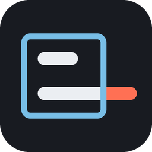

#  XamlFit

**Static text-fit audit for WPF XAML. Computes the pixel budget of every text slot without launching the app — export limits for translators before translation, fail CI on real overflow after.**

[](https://www.nuget.org/packages/Cornhsu.XamlFit)
[](LICENSE)

[繁體中文](README.zh-Hant.md)

```bash
dotnet tool install -g Cornhsu.XamlFit

xamlfit fonts export                      # once, on a machine that has your fonts
xamlfit budget ./src --csv budget.csv     # before translation: hand translators the real limits
xamlfit check  ./src --resx ./Resources   # after translation: fail CI on real overflow
```

> Requires the **.NET 10 runtime**. The analysis is pure arithmetic over XML and font tables —
> no WPF and no native dependencies.
>
> CI runs on **Linux** (Ubuntu 24.04, once normally and once in globalization-invariant mode,
> which many Linux CI images use) and on **Windows**: the unit tests, the demo audit with exact
> counts, budget mode and every CLI path.
>
> **WPF only.** WinUI/UWP, Avalonia and MAUI files are recognised and reported as *not
> analysed* — their chrome, default font and layout rules are different, and numbers computed
> with WPF's would simply be wrong.

---

## What it does that nothing else does

Every pseudo-localization tool works the same way: **run the app, switch to German, look at
every screen**. Microsoft's own localization blog described the static version a decade ago —
*"it would be possible to build a check that reports any string that won't fit"* — and nobody
built it.

XamlFit reads your XAML, works out how many pixels each piece of text actually has, measures
the real translated string against that number, and fails the build when it does not fit.

One class of bug is **only** visible this way: a `TextBlock` with `TextWrapping="NoWrap"` and
`TextTrimming="None"` does not raise `IsTextTrimmedChanged` when its text is clipped. Runtime
detection cannot see it. Static measurement can.

## The one rule

> **Say "cannot measure" rather than compute a number that is too generous.**

An available width that is over-estimated turns "does not fit" into "fits". That is the worst
thing this tool can do, so everything it cannot read is *unknown*, never *assumed default*:
a bound `Width`, a style defined in another assembly, a third-party control's template, a font
that comes from the hosting window. Each of those blocks the site and says why.

## What it can see, honestly

**Resolution** = of the text sites that have a width bound and therefore *should* yield a
number, the share that actually did. It is printed on every run and gated by `--min-coverage`.
The table below is `budget`. `check` can resolve more, because it lays a row out in document order
(the controls before a site are all it needs to know), while `budget` gives a row of controls
whose widths it cannot all read no number at all — Playnite is 66.2% under `budget` and 69.1%
under `check`.

Measured out of the box, no configuration, on sixteen projects (fonts exported with `--hinted`):

| project | localizable sites | measured | blocked | no width bound | resolution |
|---|---:|---:|---:|---:|---:|
| Cornea (maintainer app) | 68 | 59 | 0 | 9 | **100%** |
| QuillNest (maintainer app) | 685 | 538 | 3 | 117 | **99.4%** |
| Kindling (maintainer app) | 150 | 68 | 7 | 75 | **90.7%** |
| Playnite | 1,107 | 274 | 140 | 506 | **66.2%** |
| ScreenToGif | 1,277 | 167 | 203 | 790 | **45.1%** |
| HandyControl | 210 | 11 | 61 | 123 | 15.3% |
| MahApps.Metro | 1,613 | 59 | 743 | 718 | 7.4% |
| MaterialDesignInXamlToolkit | 2,339 | 0 | 867 | 1,432 | 0% |
| wpfui | 440 | 0 | 15 | 405 | 0% |
| NETworkManager (MahApps.Metro 2.4) | 1,862 | 0 | 49 | 1,727 | 0% |
| HandBrake | 705 | 63 | 102 | 520 | 38.2% |
| dnSpy | 1,265 | 27 | 488 | 326 | 5.2% |
| EarTrumpet | 66 | 1 | 3 | 0 | 25.0% |
| PowerToys (WPF parts) | 55 | 6 | 28 | 20 | 17.6% |
| WinUI-Gallery | — | — | — | — | not WPF |

0.7.0 also lists tooltips, watermarks and window titles (below). The table was measured before that.
They add sites but no measured or blocked ones, so the resolution is unchanged: ScreenToGif goes
from 1,277 to 1,555 localizable sites, QuillNest from 685 to 746, still 45.2% and 86.2% in `check`.

Read that table as two groups.

**Applications** range from 45% to 100%. What blocks the rest is concrete and printed:
a custom panel the tool has never heard of (Playnite's `GridEx`), controls whose width only
exists at run time (ScreenToGif's number boxes, colour pickers and drop-downs filled from code —
declare them with `controlWidths`), a row whose neighbour is data-bound, `SharedSizeGroup` columns.
The five added last mostly have no width to check against: NETworkManager's windows and HandBrake's
size to their content or to sizes restored at run time (1,727 and 520 sites "no width bound"); dnSpy's
text is bound to view models; EarTrumpet's sites are inside templates. EarTrumpet and HandBrake set
`TextFormattingMode="Display"`, measured from hinted widths. NETworkManager used to be 916 blocked
behind MahApps; with the measured profile 49 remain.

**Control libraries** are near zero, and that is the correct answer: in those repositories the
controls *are* the theme. Their demos take fonts from a markup extension and wrap content in
controls whose templates rebind everything. An application that *uses* one of them is in the
same position unless it tells the tool what the theme does — see
[What you have to tell it](#what-you-have-to-tell-it).

Earlier drafts of this README claimed 77–100% for the same projects. Those figures were
produced by an engine that applied default-theme padding to restyled controls, ignored the
window frame, and counted WinUI files as WPF. **A high number built on wrong assumptions is
worse than a low honest one.** The full account is in `docs/M6-全面重讀.md`.

**"No width bound" is not a safety guarantee.** It means the analysis found no bound in the
XAML — the window still has a width at runtime. Those sites are reported as
`no-declared-limit`, never as blank, and they are not counted as measured.

## How it knows

Three independent checks, each against something that is not this tool.

**Text width, against WPF's `FormattedText`.** 1,652 comparisons (faces × sizes × strings in
English, German, French, Chinese, Japanese and Korean, including kerning-heavy pairs such as
`To` and `AV`): mean error **0.006%**, worst under-estimate **0.025%**, worst over-estimate 0.26%.
Kerning comes from the font's GPOS table and is applied the way WPF does by default.

**Indic scripts, against `FormattedText`.** Devanagari, Bengali, Gurmukhi, Gujarati, Odia, Tamil,
Telugu, Kannada, Malayalam and Sinhala. Each grapheme cluster (a letter with its vowel sign, or a consonant with its
virama) is shaped at export time with the font's own rules, per language system (Nirmala UI draws ल
and श differently for Marathi), with pre-base vowel signs drawn first and two-part vowels split.
Text is the sum of its clusters, plus — for each pair of consonants joined by a virama — the smallest
narrowing any form of the second one produces, with a separate value for vowel signs and nukta forms
that narrow less than the bare consonant (Odia ୁ, Kannada ೃ), never narrower than the second cluster
alone; a chain of exactly three consonants adds a value kept per last two consonants and the sign on
the last (the widest over every first one — with a chain that starts with ra, whose reph WPF moves to
the end, kept separately; when the last consonant has no sign, the value is kept net of the first two
consonants' own join and that join is added back, since the first consonant otherwise swings the chain
by 5–15 px), longer chains the largest any chain showed; and the largest
kerning seen before punctuation. The export engine applies the shaping features in stages, as Windows
does, honours lookup flags — without them Nirmala UI's Odia conjuncts never narrowed — and applies the
mark-positioning features too, since a below-base form can widen there (Nirmala UI's `blwm` spaces two
stacked below-base forms by 550 units). It gives the reph form only to a ra + virama that starts the
syllable, as WPF does; applying it to a ra in the middle of a chain had made those chains come out narrow,
so they had fallen back to one maximum for every chain (Kannada's three-consonant words ran 28% wide). It does not reorder a
syllable the way WPF does, so where WPF would — a below-base vowel sign moves next to the base
(হ্যৃ: ৃ joins হ), a pre-base form (Telugu and Malayalam ra) is drawn before its base, a reph goes after its
consonant, Odia's candrabindu attaches to the first consonant — each join is also shaped that way and
the widest kept. In Gujarati and Telugu a cluster changes its neighbour (WPF kerns across a trailing
anusvara or vowel sign), so every cluster boundary also adds the largest widening that cluster — or
any prefix of it — produces before any other cluster; a two-consonant join adds nothing between its
halves (the join value already covers them — adding both made Telugu హ్ణ 71% wide) and, after it, the
largest widening that join showed before any letter.
Against Nirmala UI, **every** two-consonant join with every vowel sign, nukta and mark, every bare
three-consonant chain and 20,000 chains with signs — about 2.4 million strings over the ten scripts
(`WpfOracle --indic-gen` with `XF_GEN_EXHAUSTIVE=1`): worst under-estimate 0.03%. That check found
rare joins the previous version measured up to 35% narrow (Odia ଧ୍ଯି, Malayalam യ്യൢ, Bengali হ্যৃ,
Kannada ಜ್ಞು); random sampling had missed them twice. On realistic random words (two independent sets)
text measures on average 0.2% wide in Marathi, 0.6% Bengali, 0.8% Gurmukhi, 1.0–1.1% Malayalam, 1.2%
Gujarati, 1.4% Telugu, 1.5–1.7% Kannada, 1.5–1.8% Odia; 290 Marathi and 300 Tamil strings from
Playnite and ScreenToGif stay within 0.18%. Not measured: the vocalic-L signs of Odia, Kannada and
Telugu, Telugu's lone length mark ౖ, and the obsolete ఴ — WPF draws them in ways the export engine
does not.

**Khmer, Myanmar and Tibetan, against `FormattedText`.** The same cluster model, extended: Khmer coeng
(U+17D2) works like a virama, and a register shifter (៉ ៊) may come before the vowel — this export
engine draws ត៉ា 0.44 px narrower than WPF, which draws it as wide as តា, so clusters with a shifter
keep the wider of the two. A robat (៌) after anything but the base consonant, and a second coeng ro
in one cluster, are not measured: WPF draws a dotted circle. A Tibetan stack takes up to two subjoined
letters (the second only ya, ra, la or wa); with 240,000 stack-and-vowel combinations, the file stores
one value per stack — the widest over every vowel sign — plus the most any mark (ཾ ཿ ྂ ྃ) widens a
stack. **Myanmar** takes medial combinations and vowel sequences; with lookup flags honoured, the
export engine draws ဋို့ as WPF does (it was 29% narrow), and since a syllable can widen the next one
(ပျု့ + ငွီ), each boundary adds the largest widening seen after a cluster with the same marks (medials,
vowel signs, tone marks — WPF's widening hardly depends on the consonants; a bare consonant, or one with a
single mark, is keyed whole), trying every next cluster by its first drawn character and its upper marks
(ပေါ် widens before ရိ but not before ရ or ကိ). A stacked consonant (ဎ္ဘ) narrows by a value kept per
medial or vowel sign on the stacked one: with one value, the stacked ဘ of ဎ္ဘ was counted at full width.
Myanmar Text's `dist` feature pushes ြ 440 units right with a single-adjustment lookup that WPF does
not apply; the export skips that lookup for ြ only (skipping all of `dist` makes ya-medial clusters 24%
narrow). Real translations (Leelawadee UI, Myanmar Text, Microsoft Himalaya): 1,176 Khmer strings from
Survey Solutions and SystemTrayMenu measure 0.35% wide on average, 879 Tibetan strings from SOSpect
0.17%, 173 Burmese strings from Discord CustomRP and dotnet-ftps-server 0.90%; worst under-estimate
0.04%. Every Khmer join and chain (about 800,000 strings) stays within 0.04%; two sets of 3,000
generated words per script within 0.04% too, Myanmar's averaging 4.2% wide (generated syllables are
denser than real text). **Lao** adds up like Thai (≤ 0.02%).

**Mongolian, against `FormattedText`.** A Mongolian letter's glyph depends on its position, on the
word's vowel harmony, on a following variation selector, on a vowel separator (MVS) or narrow
no-break space next to it, on whether it is in the first syllable, on whether the letter before it
is a vowel, and on its neighbour (a vowel's preceding letter, a consonant's following one); a
consonant and a vowel often become one ligature that WPF counts all to the consonant. `fonts export`
runs the font's rules over every letter, every pair, every three basic letters in both genders and
400,000 random words (masculine, feminine and neutral-vowel words), and stores the widest width each
letter — or each ligature pair — took in each of those situations, plus a coarser table for
combinations it never met; text is the sum. Variation selectors draw nothing after a letter; MVS
between letters has a width (205 units in Mongolian Baiti), it is not invisible. Punctuation inside
Mongolian text is shaped with it: Mongolian Baiti's `rclt` swaps 25 marks (《 》 「 」 。 、 “ ” …) for
wider glyphs, which the file records. Against Mongolian Baiti, three sets of 4,000 generated words and
sentences: about 2.7% wide on average, worst under-estimate 0.04%; the 32 Mongolian strings Windows
ships for the mn-Mong locale (month and day names, the language name): 2.4% wide; 312 real
translations from MonkeyPaste: 1.45% wide, 0.02% narrow. Mongolian Baiti's table is about 3.5 MB of
JSON (0.55 MB gzipped).

**`TextFormattingMode="Display"`, against `FormattedText`.** Display mode snaps every glyph to a
whole pixel using the font's hinted widths, which depend on the pixel size — font size × display
scaling. Fonts that carry an `hdmx` table list those widths for common pixel sizes; on Windows,
`fonts export --hinted` asks GDI for the rest from 8 to 48 px (GDI's hinted widths are WPF's; only
kerning differs). Kerning is rounded to whole pixels, half a pixel up, and a size that lands exactly
on half a pixel (10 px at 125%) is measured at both pixel sizes, since WPF uses either. With that,
all 13,200 of WPF's widths across ten fonts, eleven sizes and five scalings are measurable: 13,036
exact, the rest wider, none narrower. The tool measures every scaling in `displayScales` (default
100–200%) and keeps the widest; a pixel size the file has no hinted widths for is reported as not
measurable, because hinting can widen a glyph by several pixels (Yu Gothic UI says hinting never
changes widths and still does). An app that only supports some scalings can say so. Variable fonts
are different: WPF does not hint them, it rounds each glyph's linear width (Segoe UI Variable Small at
10 px draws an `i` 3 px wide where GDI hints it to 2 px). The tool rounds the same way — a width just
under half a pixel may round either way, so it rounds up from 0.485 — and rounds kerning toward zero,
since WPF's own rounding of it follows no rule found: all 15 named instances, 9,900 widths, none
narrower.

**Right-to-left and Thai text, against `FormattedText`.** Hebrew, Thai and Lao add up like Latin
(≤ 0.02%). Arabic, Persian and Urdu letters change shape with their neighbours, so
`fonts export` runs each font's own substitution and positioning rules over every letter form,
every pair of letters and the three-letter contexts of `ے`, and stores only the resulting widths.
Against 500 real translated strings, 1,000 random words and every letter alone and between two
others, in Segoe UI, Arial, Tahoma, Courier New, Microsoft Sans Serif and Times New Roman: worst
under-estimate **0.05%**. Before writing a font's Arabic data the exporter checks those widths
against its own full shaping on 20,000 random words. Letters that would come out narrow are left
out (13 rare letters in Segoe UI) and are reported as not measurable next to other letters; a
font where that would be most of the alphabet gets no Arabic data at all (Calibri 6.27, whose
contextual rules span whole words). An Arabic letter joined to one drawn by another font (Dubai
has no ؿ, so a fallback font draws it) is not measurable: WPF shapes each font's run on its own and
the join breaks (measured as joined, such words came out 41% narrow). Hebrew vowel points take no
width, and a letter followed by one takes the widest glyph the font composes for it (Arial draws ע
followed by ִ as a wider ע) — about 0.5% wide with points.

**Cyrillic, Greek, Turkish, Vietnamese and Amharic, against `FormattedText`.** 300 real
translations each from Playnite (Russian, Ukrainian, Bulgarian, Serbian, Greek, Turkish,
Vietnamese — and the Vietnamese again in decomposed form, letters plus combining marks), in Segoe
UI, Arial, Tahoma, Times New Roman, Calibri, Verdana and Microsoft Sans Serif: worst under-estimate
0.03%. Getting there took five rules WPF follows: kerning applies only within a run of one script
(after Greek text, the space before "API" belongs to the Greek run, so space–A is not kerned), and
only with the lookups that script uses (Calibri's Arabic lookups kern `",`, its Latin ones do not);
a language can swap letters for other glyphs (Arial draws Turkish *i* differently, and that glyph
has no T–i kerning) or use fewer kerning lookups (Segoe UI's Turkish drops "Ta" and "Te"); WPF
composes a letter and its combining marks into one glyph when the font has it, and draws marks
with no width; and it lays text out in chunks of 100 characters, with no kerning across them.
Amharic — Windows' am-ET locale strings, 1,500 generated words and 500 sentences in Ebrima, also
through font fallback from Segoe UI: worst under-estimate 0.02%, 1.4% wide on average (Ebrima
kerns Ethiopic with lookups the export does not read).

**Layout, against real WPF windows.** `prototype/LayoutOracle` feeds 228 XAML snippets to an
actual off-screen `Window` and to the resolver, and compares what is really visible:
**186 exact, 42 conservative, 0 over-estimates** — and in `check`'s row semantics (only the
controls before it in a row count) 190 exact, 38 conservative, 0 over-estimates. The conservative ones
are deliberate — an assumed vertical scroll bar, the window frame at its widest display scaling. This harness
found most of what the last audit fixed; it needs Windows, so its conclusions are restated as
portable unit tests.

**Real projects, against real WPF windows.** `prototype/CorpusRender` loads a real project's
windows into WPF — with the project's own `App.xaml` dictionaries and each language's strings —
and records how wide every text needs to be and how much of it is actually visible. Playnite,
11 windows, 6,444 comparisons in every language including Arabic, Persian, Hebrew and Marathi (with
Playnite's GridEx declared, and an equivalent GridEx in the harness so WPF lays it out for real):
**138 clipped by both, 2 false alarms, 0 missed**, 6,304 fit by both. The false alarms are within
1.5 px. Where both agree, XamlFit's text width is −0.02 to +0.03 px off WPF's outside Devanagari and
Tamil (which err wide, by up to 7 px here), and the width it believes is available is never more
than 0.02 px too generous. ScreenToGif, 6 windows
including the editor's side panel and every kind of drop-down, 3,043 comparisons with the same
font on both sides (this machine's): **122 clipped by both, 28 false alarms, 0 missed**, 2,893 fit by
both. The false alarms are all in one side panel whose `ScrollViewer` shows its bar only when
needed; XamlFit assumes the bar is there (and says so), WPF's test window was tall enough that it
was not; declaring that panel in `hiddenScrollBars` leaves 1 false alarm (0.8 px) and still 0 missed
(3,540 comparisons once Arabic, Hebrew and Tamil are measured too: 133 clipped by both, 2 false
alarms — the second a Tamil title measured 5 px wide — 0 missed). Another 76 are Expander headers that WPF draws 0.5–1.2 px short of their text with 200 px
to spare, because `UseLayoutRounding` rounds every layer to device pixels. English loses up to
0.4 px at the same places; the loss does not grow with the text. That is the pixel grid, not a
translation that does not fit, so XamlFit does not report it and the comparison counts it apart. These comparisons found the bugs listed in `docs/M6-全面重讀.md`.

**False positives, against shipped software.** Hard-coded text in a released app presumably
fits. So the tool checks the *source* language too: **1,185 source-language measurements across
the corpus.** While it was being built this number was not zero four times. Twice the tool was
wrong. The third time — two overflows in the maintainer's own app, which appeared when the tool
learned to measure Runs and restyled column headers — it was right: drawn by WPF, a note in a
horizontal `StackPanel` needs 935.7 px and shows 563.5, and a column header needs exactly the
126.16 px the tool computed in a 114 px slot. The fourth — four drop-down options in ScreenToGif's
editor, measurable once children spanning an `Auto` column were understood — was right too: WPF
shows 122.4 px of "Sum evenly with the remaining frames", which needs 214.8. A fifth in ScreenToGif,
checked later, is real as well: the scaling-quality drop-down of the resize panel shows 224 px of
"Nearest neighbor • Lower quality and faster", which needs 244.6 (drawn in WPF with the panel inlined
into the editor window).

## What you have to tell it

Some things are not in the XAML. The tool reports them as blocked and names them; you declare
them once in `xamlfit.config.json`.

```jsonc
{
  // Horizontal padding (left + right, DIPs) of controls the tool does not know:
  // third-party controls, or standard ones restyled by an external theme.
  "chrome": { "Card": 16, "MetroWindow": 2, "GroupBox.Header": 9 },

  // A subclass that lays out exactly like its base. You are vouching for that.
  "treatAs": { "MyGrid": "Grid" },

  // A Grid subclass that generates its columns from properties (Playnite's GridEx). Each value is
  // the property name that class uses: a column count (all Auto), a list of star column indexes,
  // and "place the children in reading order, N per row" (which overrides their Grid.Column).
  "gridPanels": { "GridEx": { "columnCount": "ColumnCount", "starColumns": "StarColumns",
                              "autoLayoutColumns": "AutoLayoutColumns" } },

  // The widest a control sized at run time ever gets: a number box showing a value, a drop-down
  // filled from code. Used only where that control takes room from text next to it; an explicit
  // Width still wins and MinWidth/MaxWidth still clamp it. Declare the real maximum — too small
  // and the text is given room it does not have. The tool never guesses this number.
  "controlWidths": { "IntegerUpDown": 100 },

  // ScrollViewers or lists (by x:Name) whose vertical scroll bar never shows, because their content is
  // never taller than they are. Otherwise an `Auto` bar is assumed to be there and takes its width.
  "hiddenScrollBars": ["ActionScrollViewer"],

  // Display scalings (1 = 100%) TextFormattingMode="Display" text must fit at. Default: 1, 1.25,
  // 1.5, 1.75, 2. Display widths come from the font's hinted widths for each pixel size.
  "displayScales": [1, 1.25],

  // A family in a FontFamily fallback list that target machines do not have.
  "absentFonts": ["Segoe UI Variable"],

  // The language the app is written in (see "The default font" below).
  "sourceCulture": "zh-Hant",

  // An external theme was detected, but it does not change control padding.
  "assumeDefaultTheme": false,

  // A resizable window can be shrunk to its MinWidth. Use that, not Width, as the bound: the
  // report then answers "does it fit when the window is as small as it gets", which is where
  // translations overflow first. Off by default; the bound is labelled as coming from MinWidth.
  "assumeWindowMinWidth": false,

  // The widest a popup (ContextMenu, ToolTip, Popup, submenu) may grow. Popups size to their
  // content and never clip, so they are not checked unless you declare this; then text in them
  // is held to it (minus the measured popup chrome) and the report says the limit is declared.
  // Menu-bar items are not affected: a Menu wraps its items.
  "popupMaxWidth": 400,

  // Check standard window titles against the Windows 11 title bar, measured at 100–175% (the only
  // value). A title that does not fit is reported as trimmed: Windows shortens it with an ellipsis.
  // Without it, titles are listed as drawn-by-windows and not checked.
  "windowTitleBar": "windows11",

  // What your Visibility converters mean: the bound value that makes the element visible. Two
  // elements in the same row bound to the same property through opposite converters are never shown
  // together, so one is not deducted from the other. WPF's BooleanToVisibilityConverter needs no entry.
  "visibilityConverters": { "BoolToVis": true, "InverseBoolToVis": false }
}
```

Declaring Playnite's `GridEx` as above takes its resolution from 66.2% to 77.5%.

Every run ends with the controls whose chrome it could not determine, ordered by how many
sites each one blocks — so you know which three lines of config are worth writing.

### External themes

If `App.xaml` merges a dictionary from another assembly (`MaterialDesignThemes.Wpf`, `Wpf.Ui`,
`HandyControl`, …), standard controls are restyled by XAML the tool cannot read: a Material
Design `Button` has 32 px of padding, not 4. The built-in table no longer applies, so sites
inside those controls become blocked until you declare their chrome.

Four libraries are **measured** and work without configuration: **MahApps.Metro 2.4**,
**MaterialDesignThemes 5.3** (`MaterialDesign2.Defaults.xaml` or `MaterialDesign3.Defaults.xaml`),
**HandyControl 3.5** and **WPF-UI 4.3** (`ui:ThemesDictionary` / `ui:ControlsDictionary`).
`prototype/ThemeChrome` loads each theme the way an application does and measures, in WPF, every
standard control's chrome, what an explicit `Padding`/`BorderThickness` does to it, the font size
and weight the style sets, whether string content is drawn in capitals (a MahApps `Button` draws
"Save" as 10 px bold "SAVE"; its "Square" buttons are lowercase), minimum widths and the scroll bar
width — for the implicit styles and for every keyed style (`MahApps.Styles.Button.Square`,
`MaterialDesignOutlinedButton`…), so project styles `BasedOn` them resolve too. A profile is used
only when the project's package reference has the same major.minor version and no unmeasured theme
shares its scope. Against real WPF windows with each theme merged (`prototype/LayoutOracle --theme`,
43 cases each, normal and `check` row semantics): MahApps 42 exact / 1 conservative, MaterialDesign
2 and 3 each 41 / 2, HandyControl and WPF-UI each 26 / 17, **0 over-estimates**; Material Design's
switch-style `ToggleButton` is reported as not measurable. HandyControl and WPF-UI round most
controls' widths to device pixels inside their templates; such a control, as a neighbour, is given
one extra pixel (that rounding made two neighbours 0.7 px wider than measured before).

### Templates in your own project

When *your* project replaces a `ControlTemplate`, nothing needs declaring: the tool reads the
template, substitutes `{TemplateBinding Padding}` with what the control actually has, and
works out the chrome. If the same style exists in several theme files (light and dark), it
computes each and accepts the answer only when they agree.

That includes `ListBox`, `ListView` and `ItemsControl` (0.7.0): the chrome is whatever lies between
the control's edge and the template's `ItemsPresenter`, and a `ListBox`/`ListView` still scrolls the way
its own `ScrollViewer.*` settings say. A template whose `ScrollViewer` fixes its own scroll bars, or that
lays the items out in an `IsItemsHost` panel, is not measurable. `TreeView` and `DataGrid` templates are not
read.

### The default font

WPF's default font is not Segoe UI. It is the *system message font*, and it follows the
Windows display language: Segoe UI on English or German Windows, **Microsoft JhengHei UI** on
Traditional Chinese, Microsoft YaHei UI on Simplified Chinese, Yu Gothic UI on Japanese,
Malgun Gothic on Korean. Latin letters in JhengHei UI are about 7% wider than in Segoe UI.

So text with no explicit `FontFamily` has a different width on different users' machines.
`check` measures each culture with that culture's font, and reports — exit 3 — a culture whose
font is missing from the metrics file rather than measuring it with the wrong one.

A `UserControl` inherits its font from whichever window hosts it, which is in another file.
The tool follows the placement: the file whose root has `x:Class="App.Views.CanvasView"` is
hosted wherever `<views:CanvasView/>` appears, through nested user controls up to a window, and
the value at that element is what the control inherits. Placed in windows that disagree, or in a
resource dictionary, the inherited value is unknown, and the report names the files. A control no
XAML file places (created in code) falls back to the consensus of the windows in the same
application; if they disagree, pin `defaultFontFamily` / `defaultFontSize`.

The same placement gives a user control its **width**: text inside `CanvasView.xaml` has no bound
in that file, so the walk continues from the `<views:CanvasView/>` element in the window that
places it (a Grid column there, the window's own Width). Placed in several files, the narrowest
wins; a placement that cannot be resolved blocks the site, because that one may be narrower.
A control no XAML file places still has no declared limit.

## Fonts

No SkiaSharp, no WPF, no native binaries. XamlFit reads a handful of tables out of a font file
and sums advance widths: `width = Σ advance(codepoint) × fontSize ÷ unitsPerEm`.

```bash
xamlfit fonts export --family "Segoe UI" --family "Microsoft JhengHei UI" --family "Segoe UI Symbol"
git add xamlfit.fonts.json.gz
```

The file is gzipped JSON: with many families it is large (37 families with complex-script fonts:
about 38 MB of JSON, 6 MB gzipped). `--out xamlfit.fonts.json` writes it uncompressed; every command
reads either, and when a folder has both, the newer one.

The metrics file contains **numbers only** — advance widths, kerning adjustments, and the widths
of Arabic letter forms worked out from the font's own rules, and with `--hinted` (Windows) the
whole-pixel widths GDI gives each character from 8 to 48 px. No glyph outlines, no font software.
You generate it from fonts you already have a licence for, into your own repository. CI needs
no fonts installed.

It will not substitute a font it has for one it lacks:

- the *first* family in a fallback list must be in the file (a later one is only a fallback);
- bold text is not measured with the regular face;
- a variable font answers for its named instances only, under the family names WPF uses —
  Segoe UI Variable becomes `Segoe UI Variable Text`, `Small` and `Display`, each with its Light,
  Semilight, Regular, Semibold and Bold widths from the font's `HVAR` and kerning variations.
  `Segoe UI Variable` itself is not a family to WPF: it reads a name that is not an installed family
  as the longest installed family it starts with plus a face name — Segoe UI, Bold if `FontWeight`
  says so; `Times New Roman Italic` is italic, an unknown word is ignored. The tool does the same when
  the file lists the families installed where it was exported (new exports do), so that a real font
  missing from the file — `Segoe UI Historic` — is never measured as Segoe UI;
- `TextFormattingMode="Display"` text is not measured with linear widths (measured against WPF:
  −37% to +45%); it needs hinted widths for its pixel size (`fonts export --hinted`).

Each of these makes the site unmeasurable and names the font to export.

**Inline text.** A `Run` on its own line (between `<LineBreak/>`s) is an ordinary line. On a line
that does not wrap, a `Run` gets what the content before it leaves, because the line is drawn
from the left and clipped on the right; whitespace between elements is one space in the
TextBlock's font (measured: `--inlines`). A `Run` alone in a `Hyperlink`, `Span` or
`Underline` is that link. A `Run` after a binding, or on a wrapping line with a height limit,
is unmeasurable.

**Characters the font cannot draw** are drawn the way WPF draws them, which was measured, not
assumed: first from **another face of the same family** (Microsoft JhengHei UI Regular has no
Cyrillic; its Light face does, and WPF uses it even for bold text), then from WPF's own
fallback table (`GlobalUserInterface.CompositeFont`, MIT-licensed, bundled as
`data/font-fallback.json`). That table depends on the element's `Language` — `en-US` unless
`xml:lang` says otherwise — **not** on the Windows display language: on any Windows, an app
that does not set `Language` draws Chinese with Yu Gothic UI. A character none of WPF's
candidates in the metrics file can draw is unmeasurable, and the report names the candidates.
Invisible characters (variation selectors, zero-width space and joiner, BOM) have no width.

### Font metrics and licensing

Nobody has said whether extracting these numbers from a commercial font is allowed. Microsoft's
font redistribution FAQ forbids redistributing, modifying or converting the fonts and says nothing
about metrics, and no court has ruled on font metrics either way. XamlFit itself ships metrics for
no proprietary font: you generate the file from fonts licensed to your machine. Everything the file
holds is listed in [THIRD-PARTY-NOTICES.md](THIRD-PARTY-NOTICES.md#font-metrics). This is not
legal advice.

- **Private repository:** the file stays where your fonts' licence already applies, with your team.
- **Public repository:** committing the file publishes numbers derived from commercial fonts. Until
  there is an answer, prefer generating it in CI (below) instead of committing it, and do not upload
  it as a workflow artifact — a public repository's artifacts can be downloaded.
- **Segoe UI Variable is skipped** unless you name it with `--family`: Microsoft's FAQ says it is
  not available for licensing or use outside Microsoft products.
- The file lists only the installed family names that resolving a name needs (the exported families
  and installed families whose names begin with one of them), not everything installed on the
  machine that exported it.

**Generating the file in CI.** GitHub's Windows runners (`windows-2022` and `windows-2025`, checked
on 2026-11-19) have Segoe UI, Microsoft JhengHei UI, Microsoft YaHei UI, Yu Gothic UI, Malgun Gothic,
Nirmala UI, Leelawadee UI, Myanmar Text, Mongolian Baiti, Calibri, Tahoma and Arial, among others;
Segoe UI Variable is on `windows-2025` only. Exporting three families took about 30 s, with
`--hinted` about 4 minutes. The widths matched a Windows 11 desktop export for every character
compared. The runners' Segoe UI covers slightly fewer code points (`windows-2022` the fewest), so a
rare character a desktop export can measure may be unmeasurable there: reported, not measured wrong.
Prefer `windows-latest`. The [GitHub Action](#github-action) does it for you:

```yaml
jobs:
  fit:
    runs-on: windows-latest
    permissions:
      contents: read
      pull-requests: write
    steps:
      - uses: actions/checkout@v4
      - uses: HSU-YU-MING/cornhsu-xamlfit@v0.11.0
        with:
          root: src/MyApp
          resx: src/MyApp/Resources
          version: 0.11.0
          export-fonts: Segoe UI, Microsoft JhengHei UI
```

`export-fonts` exports those families from the runner's fonts, runs the check with them and deletes
the file before anything is uploaded. It needs a Windows runner (on Linux it is refused) and cannot
be combined with `metrics`.

## `budget` — before translation

The unit is the **string**, not the UI slot:

> **a string's budget is the place where it runs out of room first.**

```csv
key,limit_px,limit_chars,status,font,size,binding_site,source,source_px,headroom_px,…
Save,64.0,10,measured,Segoe UI,12,MainToolbar.xaml:42,Save,31.4,32.6,…
Help,,,wraps,Segoe UI,12,About.xaml:9,…
Unbounded,,,no-declared-limit,,,,…
```

`limit_px` is authoritative; `limit_chars` is an estimate, because glyph widths differ. Four
statuses, never a blank cell:

| status | meaning |
|---|---|
| `measured` | `limit_px` applies |
| `wraps` | the text wraps and its height is free — only a single word wider than the line is cut |
| `no-declared-limit` | no width bound found in the XAML. **Not** a guarantee |
| `not-analysed` | a bound exists but could not be resolved |

`--sites sites.csv` writes one row per text site with the reason it is blocked.

Text fields that start with `=`, `+`, `-`, `@`, a tab or a carriage return are prefixed with a
single quote so a spreadsheet does not run them as formulas. Use `--csv-raw` for byte-exact
strings when feeding an API — and do not open that file in Excel.

## `check` — after translation

```bash
xamlfit check ./src --resx ./Resources --baseline xamlfit-baseline.json
```

Translations come from `.resx` (`{x:Static p:Strings.Save}`) and from XAML string dictionaries
(`<sys:String x:Key="Save">` with `{DynamicResource Save}`), which are found automatically.
The second form is by far the more common in real WPF applications.

| the text | result | severity |
|---|---|---|
| does not wrap, no trimming, too wide | `overflow` — spills out or is clipped | **fail** |
| does not wrap, ellipsis, too wide | `trimmed` — information lost | warn |
| wraps into more lines than a fixed height holds | `vertical-clip` | **fail** |
| wraps into more lines than the source language | `reflow` — layout grows | info |
| does not wrap, less than `--margin` slack | `tight` | warn |

Line counts come from real word wrap, not total width divided by line width.

With translations, `check` also looks at the string tables themselves — every key, not only the ones
the XAML refers to, because strings used from code are translated too:

| the string | result | severity |
|---|---|---|
| the source has `{0}`, the translation uses an index the source does not have, or a stray `{`/`}` | `placeholder-mismatch` — `String.Format` throws `FormatException` | **fail** |
| the translation drops an index the source has (`{1}`) | `placeholder-mismatch` — that value is not shown | warn |
| the key has no value in a language | `missing-translation` — WPF shows the source text | warn |
| text written straight into the XAML, in a project that has translations | `hard-coded-text` — every language shows it | info |

The default gate (`--fail-on fail`) only blocks the one that crashes; `--fail-on warn` blocks missing
translations too. The source language is the neutral table, else `en-US`/`en`. A missing key points
at its line in the source `.resx`; a placeholder mismatch at its line in the translation. Not run
with `--source-only` or `--pseudo`.

Three things that are easy to get wrong and are checked against WPF:

- **Wrapping that cannot happen.** Inside a horizontal `StackPanel`, an `Auto` grid column or a
  `WrapPanel`, WPF measures the child with unlimited width: `TextWrapping="Wrap"` does nothing
  and the text is cut. That is reported as `overflow`, not as harmless `reflow` — unless the text
  or something between it and that panel has its own `Width`/`MaxWidth`, which WPF wraps at.
- **Rows of translated strings.** A row of buttons shares its width. What is left for one
  depends on how wide the others are *in that language* — so each culture is laid out again
  with its own strings.
- **Access keys.** In `_Save` on a `Button`, `Label`, `CheckBox`, `MenuItem`… the underscore is
  not drawn. On a `TextBlock` or `ListBoxItem` it is.

On two public projects with their real translations — Playnite (38 languages, 9,400
measurements) and ScreenToGif (29 languages, 3,067 measurements) — it reported 133 overflows at
21 sites and 131 at 15. All 133 in Playnite were checked by drawing the windows in WPF: 130 are
really clipped, 3 are false alarms. ScreenToGif's 5 in English are real (see above). A string
with no translation is judged too, in each language's own layout: WPF shows the English text
there, next to translated neighbours that may be wider.

A row of controls shares its width **in document order**: the ones written first get what they
need, and a long translation pushes the ones after it out of the window. That is how WPF lays
out a horizontal `StackPanel` or `DockPanel`, and it is what `check` reports.

What is *not* judged is counted and printed: strings with run-time placeholders (`{0}`), text
the metrics do not cover (with the code points, so you know which font to export), and
scripts that reshape in a way the metrics do not cover (Mongolian letters in a situation the export
never saw, Arabic letters a font's data leaves out, Indic sequences that are not a grapheme cluster), and Display-mode
text at a pixel size the font has no hinted widths for. **A culture in which nothing
could be measured makes the run exit 3** — "not checked" must not look like "passed".

`--source-only` checks just the source language and needs no translations. `--pseudo`
simulates expansion from a length-bucketed table (`< 10` chars → 200%, `11–20` → 180%,
`21–30` → 160%, `31–50` → 130%, `50+` → 120%); its findings are downgraded one level and never
fail a build, because a guess should not block someone's pull request.

### Exit codes

| | |
|---|---|
| 0 | pass |
| 1 | findings at or above the gate (`--fail-on fail` by default) |
| 2 | usage, config or input error |
| 3 | **result not trustworthy** — resolution below `--min-coverage`, nothing measured, or a whole culture that could not be measured |

## Known limitations

| | handling |
|---|---|
| `ControlTemplate` / `DataTemplate` contents | width is decided where the template is used; counted separately as "in a template" |
| A `ContentTemplate` / `HeaderTemplate` that draws a control's string content | a template that is a single `TextBlock Text="{Binding}"` is read (its wrapping and trimming apply); any other template makes the site unmeasurable |
| An element with `Width` inside something narrower *and unresolvable* | the explicit `Width` is taken at face value. When the outer width *is* resolvable, the smaller wins |
| A label in an `Auto` column | budgeted up to the point where it would be clipped; it will squeeze `*` columns before that |
| Fonts set by a control's own template or by code | not visible; the site's font is whatever the XAML says |
| Styles applied by triggers, visual states or code-behind | not followed |
| `ToolTip` | a site with no width bound, unless `popupMaxWidth` is declared: then that minus the tooltip's 14. Drawn in the system font at 12, not the owner's font (measured in WPF) |
| Watermark / hint text | measured where it was checked in real windows: MahApps 2.4 `TextBox` (width − 10), MaterialDesign 5.3 `TextBox` (width − its `Padding`), WPF-UI 4.3 `ui:TextBox` (width − 21.6). Other libraries, controls, a set `BorderThickness` or another style: listed, not measurable |
| A text element with an `x:Name` and no text in the XAML | its text is filled by code, so its width is unknown. A site sharing a row with it gets only an upper bound: it is counted as blocked, and `check` still reports it when the text does not fit even that (the neighbour's `Margin` and `MinWidth` are all that is deducted) |
| Elements whose `Visibility` is bound | counted as visible when they share a row, which can only make the space look smaller. Declare `visibilityConverters` so that two elements shown under opposite conditions are not deducted from each other |
| A standard window's `Title` | listed as `drawn-by-windows` and not counted in the resolution, unless `windowTitleBar: "windows11"` is declared. Then it is checked against the Windows 11 title bar, measured at 100%, 125%, 150% and 175% with four window widths, taking the largest loss: 194 DIP for `SingleBorderWindow` with `CanResize`, `CanMinimize` or `CanResizeWithGrip`, 96 with `NoResize`, 200 for `ThreeDBorderWindow` with `CanResize`, 76 for `ToolWindow` (other combinations are not measured). Windows 11 draws titles in Segoe UI 12, not the system caption font, within 1 DIP of its linear widths across 22 strings. CJK ideographs and full-width forms count as 1 em; other characters Segoe UI lacks are not measurable, because Windows fills them with its own font linking. Windows 10 and 200% are not measured |
| Resource dictionaries merged in code at run time | every dictionary file is assumed merged; conflicting definitions make the value unknown. In ScreenToGif, Playnite and three applications no site was blocked by a conflict, so following `MergedDictionaries` is not planned |
| Mongolian | the sum of the widest width each letter or ligature pair took in the same situation at export time, erring wide (about 2.5%); a letter in a situation the export never saw is not measurable; checked against generated words, 32 strings from Windows' locale data and 312 real translations |
| Indic scripts (Devanagari, Bengali, Gurmukhi, Gujarati, Odia, Tamil, Telugu, Kannada, Malayalam, Sinhala), Khmer, Myanmar, Tibetan | measured as the sum of grapheme clusters, erring wide (Odia and Kannada by up to 2%, Myanmar's generated words by 4.2%, real Burmese by 0.9%); never more than 0.18% narrow in the comparisons, including every two-consonant join of the Indic scripts and Khmer |
| `TextFormattingMode="Display"` | measured from the font's hinted widths at every scaling in `displayScales` (variable fonts: rounded linear widths); a pixel size a static font does not list is not measurable |
| Arabic-script fonts whose contextual rules reach further than three letters | the letters involved, or the whole font, are reported as not measurable (see above) |
| Nastaliq fonts (Urdu Typesetting) | letters joined by cursive attachment are not modelled: a font with at least 100 cursively attached glyphs, most of them anchored away from the glyph edges, gets no Arabic data (not measurable). Inferred from the font structure only: no Nastaliq font was available to check against WPF. Dubai, which uses cursive attachment lightly, measures within 0.03% |
| Scripts that need shaping and are not modelled (Javanese, Balinese, Sundanese, Batak, Tai Tham, Cham, Meetei Mayek, Adlam, Hanifi Rohingya, Brahmi-derived scripts outside the ten Indic ones, conjoining Hangul jamo…) | not measurable, rather than a sum of advance widths |
| `TextFormattingMode="Display"` with combining marks, or with a letter the element's language draws as another glyph | not measurable |
| Native digits | WPF swaps 0–9 for Arabic-Indic digits in Arabic text, and always when the element's language is Burmese, Dzongkha, Nepali (India), Pashto, Sindhi, Kashmiri, Urdu (India), Punjabi or Uzbek in Arabic script, Mazanderani or Northern Luri (Myanmar Text's ၀ is 17% wider than 0); both are measured and the wider one is used. In `Display` mode the swapped digits are not measurable |
| Ligatures other than Arabic (`fi`, `ffl`…) | not applied; covered by the text-width comparison above (worst under-estimate 0.025%) |
| Vertical clipping | only when the text element itself declares `Height`/`MaxHeight` |
| Window frame, scroll bar width | taken at the display scaling where they are largest in DIPs |
| Default UI font per language | only Traditional Chinese was measured on a real system; the others are from Windows' font configuration. Override with `defaultFontByCulture` |

## Configuration

`xamlfit.config.json` next to the scanned root, or `--config <path>`. Besides the keys under
[What you have to tell it](#what-you-have-to-tell-it):

```jsonc
{
  "schemaVersion": 1,
  "defaultFontFamily": "Segoe UI",
  "defaultFontSize": 12,
  "marginPercent": 5,
  "minCoverage": 60,
  "metrics": "xamlfit.fonts.json",
  "exclude": ["/Generated/"],
  "resx": ["Resources"],
  "cultures": ["de", "fr"],

  // The element language WPF uses to pick fallback fonts. WPF's default is en-US whatever
  // the Windows language. "culture" means: your app sets Language to the UI culture.
  "elementLanguage": "en-US"
}
```

Comments and trailing commas are allowed. Relative paths are relative to the config file.
**Command-line flags always win over the file.** A misspelled property is an **error**, not a
silent skip: the run exits 2 and names it.

## CI output

```bash
xamlfit check ./src --resx ./Resources --sarif fit.sarif --msbuild
```

`--md <path>` writes a Markdown report for a PR comment (everything taken from the repository is
in code spans, so a key or a path cannot turn into a link or an @mention). `--sarif` writes SARIF
2.1.0 for GitHub code scanning. `--msbuild` prints MSBuild diagnostics
on stdout, so a build that runs the tool via `Exec` surfaces them in the Visual Studio Error
List: `XF0001` for gated findings, `XF0002` for warnings, `XF0003` when the result is not
trustworthy.

### GitHub Action

```yaml
permissions:
  contents: read
  pull-requests: write            # for the PR comment
  security-events: write          # only with sarif: true
steps:
  - uses: actions/checkout@v4
  - uses: HSU-YU-MING/cornhsu-xamlfit@v0.11.0
    with:
      root: src/MyApp
      resx: src/MyApp/Resources
      version: 0.11.0              # pin the tool too
      sarif: true                 # upload to code scanning
```

The action installs .NET and the tool, runs `xamlfit check`, annotates every finding on its line
in the PR, posts the Markdown report as one PR comment that later runs update, uploads the JSON and
Markdown reports as a workflow artifact, uploads SARIF to code scanning when
asked, and only then fails the job on the check's exit code, so a red PR still shows the whole
report. It has the same shape as the XamlContrast action (inputs are validated before anything
is installed; the tool's output is wrapped in `::stop-commands::`, because the XAML and `.resx`
it prints are untrusted input).

| Input | Default | What it does |
|---|---|---|
| `root` | required | folder to scan |
| `working-directory` | `.` | folder to run in; the paths below are relative to it |
| `version` | latest | tool version to install; the tool is 0.x, so pin it |
| `resx` | config file | folder holding the `.resx` translations |
| `metrics` | next to `root` | font metrics file |
| `export-fonts` | none | Windows runners: comma-separated families to export from the runner's fonts for this check; deleted before anything is uploaded (see [Font metrics and licensing](#font-metrics-and-licensing)) |
| `config` | next to `root` | `xamlfit.config.json` |
| `baseline` | none | ratchet file: only new findings fail |
| `pseudo` | `false` | simulate expansion instead of real translations (never fails the job) |
| `fail-on` | config, else `fail` | `fail` or `warn` |
| `min-coverage` | config, else 60 | resolution floor; below it the job exits 3 |
| `sarif` | `false` | upload SARIF to code scanning (needs `security-events: write`) |
| `comment` | `true` | post the report as a PR comment (needs `pull-requests: write`; without it the comment is skipped, the gate still works) |
| `upload-report` | `true` | upload the JSON and Markdown reports as an artifact |
| `artifact-name` | `xamlfit-report` | artifact name, and the code-scanning category when the action runs twice in one run |

The path is passed after `--`, so a folder named like a flag is still scanned as a folder.

Suppress a single slot with a reason — the reason is required, and suppressed slots are counted:

```xml
<!-- xamlfit-ignore: decorative, never translated -->
<TextBlock Width="40" Text="{x:Static p:Strings.Arrow}"/>
```

## Related tools

[XamlContrast](https://www.nuget.org/packages/Cornhsu.XamlContrast) audits WCAG contrast in the
same XAML, and [XamlKeys](https://www.nuget.org/packages/Cornhsu.XamlKeys) audits resource-key
scope. Same exit-code contract, same baseline shape, same mental model.

## Licence

MIT. See [THIRD-PARTY-NOTICES.md](THIRD-PARTY-NOTICES.md) for bundled data.
