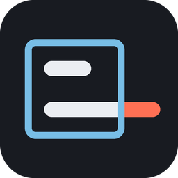

#  XamlFit

**WPF XAML 文字容納度的靜態稽核。不開 App 就算出每個文字位置有多少像素 ——
翻譯之前把限制交給譯者，翻譯之後讓 CI 擋下真正的溢出。**

[English](README.md)

```bash
dotnet tool install -g Cornhsu.XamlFit

xamlfit fonts export                      # 在有字型的機器上跑一次
xamlfit budget ./src --csv budget.csv     # 翻譯之前：把真實的像素上限交給譯者
xamlfit check  ./src --resx ./Resources   # 翻譯之後：真的裝不下就擋 CI
```

> 需要 **.NET 10 runtime**。解析與量測都是純算術，不相依 WPF、沒有原生二進位。
>
> CI 在 **Linux**（Ubuntu 24.04，一般模式與很多 Linux CI 映像檔用的 globalization-invariant 模式各跑一次）
> 與 **Windows** 上跑：單元測試、示範專案的精確計數、budget 模式、每一條 CLI 路徑。
>
> **只做 WPF。** WinUI／UWP、Avalonia、MAUI 的檔案會被辨識出來並回報「沒有分析」——
> 它們的控制項內距、預設字型、版面規則都不一樣，拿 WPF 的去算只會得到錯的數字。

## 它做了什麼別人沒做的事

所有偽本地化工具的做法都一樣：**把 App 跑起來、切到德文、一頁一頁看**。
微軟自己的在地化部落格十年前就描述過靜態版本，到今天沒有人做。

XamlFit 讀你的 XAML，算出每段文字實際有幾個像素，拿真實的譯文去量，裝不下就讓建置失敗。

有一類 bug **只有**這樣看得到：`TextWrapping="NoWrap"` 加 `TextTrimming="None"` 的
`TextBlock` 被裁切時**不會觸發 `IsTextTrimmedChanged`**。執行期偵測看不到，靜態量得出來。

## 唯一的一條規則

> **寧可說「量不到」，也不要算出一個偏大的數字。**

可用寬度高估，就是把「裝不下」說成「裝得下」—— 那是這支工具最嚴重的失敗。
所以凡是它讀不出來的東西都是**不知道**，不是**當成預設值**：綁定的 `Width`、定義在別的組件裡的樣式、
第三方控制項的範本、從宿主視窗繼承來的字型。每一種都會把那個位置擋下來，並且說明原因。

## 它看得到多少（老實說）

**可解析率** = 有寬度上界、本來就該算得出數字的文字位置裡，實際算出來的比例。
每次執行都會印出來，低於 `--min-coverage` 時回 exit 3。
下表是 `budget` 的數字。`check` 可以解得更多：它照文件順序排一整排（只需要知道某個位置**前面**的控制項多寬），
`budget` 則是整排有一個寬度讀不出來就不給數字 —— Playnite 在 `budget` 是 66.2%、在 `check` 是 69.1%。

不寫任何設定檔，直接跑十一個專案：

| 專案 | 可在地化位置 | 量得到 | 卡住 | 查不到上界 | 可解析率 |
|---|---:|---:|---:|---:|---:|
| Cornea（自家 App） | 68 | 59 | 0 | 9 | **100%** |
| QuillNest（自家 App） | 685 | 538 | 3 | 117 | **99.4%** |
| Kindling（自家 App） | 150 | 68 | 7 | 75 | **90.7%** |
| Playnite | 1,107 | 274 | 140 | 506 | **66.2%** |
| ScreenToGif | 1,277 | 167 | 203 | 790 | **45.1%** |
| HandyControl | 210 | 11 | 61 | 123 | 15.3% |
| MahApps.Metro | 1,613 | 59 | 743 | 718 | 7.4% |
| MaterialDesignInXamlToolkit | 2,339 | 0 | 867 | 1,432 | 0% |
| wpfui | 440 | 0 | 15 | 405 | 0% |
| NETworkManager（MahApps.Metro 2.4） | 1,862 | 0 | 49 | 1,727 | 0% |
| HandBrake | 705 | 63 | 102 | 520 | 38.2% |
| dnSpy | 1,265 | 27 | 488 | 326 | 5.2% |
| EarTrumpet | 66 | 1 | 3 | 0 | 25.0% |
| PowerToys（WPF 的部分） | 55 | 6 | 28 | 20 | 17.6% |
| WinUI-Gallery | — | — | — | — | 不是 WPF |

這張表要分兩群看。

**應用程式**從 45% 到 100%。卡住的原因都很具體，而且會印出來：工具沒見過的自訂面板
（Playnite 的 `GridEx`）、寬度要到執行期才知道的控制項（ScreenToGif 的數值框、顏色選擇器、程式碼填項目的下拉選單 ——
用 `controlWidths` 宣告）、同一排的鄰居是綁資料的、`SharedSizeGroup` 的欄。
最後加的五個大多沒有寬度可以對：NETworkManager 與 HandBrake 的視窗依內容或執行期還原的大小決定寬度（各 1,727 與 520 個位置「沒有寬度上限」）；
dnSpy 的文字綁在 ViewModel 上；EarTrumpet 的位置都在範本裡。EarTrumpet 與 HandBrake 用 `TextFormattingMode="Display"`，用 hinting 寬度量。
NETworkManager 原本 916 個位置卡在 MahApps，用了量過的佈景之後剩 49 個。

0.7.0 起也列出 ToolTip、浮水印與視窗標題（見下面「已知限制」）；上面的表是在那之前量的。
它們只增加位置、不增加量得到或卡住的位置，所以可解析率不變：ScreenToGif 的可在地化位置 1,277 → 1,555、
QuillNest 685 → 746，`check` 的可解析率仍是 45.2% 與 86.2%。

**控制項庫**幾乎是零，而那是對的答案：在那些 repo 裡，控制項**就是**佈景。
用了它們的應用程式也會落在同樣的處境，除非告訴工具那個佈景做了什麼 —— 見下面「要你告訴它的事」。

這份 README 的前幾版對同樣的專案寫的是 77~100%。那些數字是用一個「把預設佈景的內距套到重畫過的控制項上、
沒扣視窗邊框、把 WinUI 的檔案當成 WPF」的引擎算出來的。
**用錯的假設堆出來的高數字，比誠實的低數字糟。** 完整經過在 `docs/M6-全面重讀.md`。

⚠ **「查不到寬度上界」不等於安全。** 它的意思是分析在 XAML 裡找不到上界 —— 執行期的視窗仍然有寬度。
這類位置一律報成 `no-declared-limit`，**永遠不是空白**，也不算量得到。

## 它憑什麼這樣說

三種互相獨立的驗證，每一種的對照都不是這支工具自己。

**文字寬度，對照 WPF 的 `FormattedText`。** 1,652 組比對（含 `To`、`AV` 這類字距調整多的配對）：
平均誤差 **0.006%**、最大低估 **0.025%**、最大高估 0.26%。字距調整從字型的 GPOS 表取，照 WPF 預設的方式套。

**印度系文字，對照 `FormattedText`。** 天城文、孟加拉文、古木基文、古吉拉特文、奧里亞文、坦米爾文、泰盧固文、卡納達文、馬拉雅拉姆文、僧伽羅文。
每個字素叢集（字母加母音符號，或子音加 virama）在匯出時用字型自己的規則跑過，依語言系統分開（Nirmala UI 的馬拉地文 ल、श 字形不同），
畫在前面的母音符號先移到前面、兩段式母音拆開。文字的寬度是各叢集相加，再加上：兩個子音用 virama 連寫時，後一個子音各種形式裡**最少**變窄多少
（比單獨子音變窄得少的母音符號與 nukta 形式另外記，例如奧里亞文 ୁ、卡納達文 ೃ；帶母音符號時不會比後一個叢集自己窄），
剛好三個子音連寫時加上依「後兩個子音、最後一個子音帶的符號」記的值（所有第一個子音裡最寬的；第一個子音是 ra 的 —— WPF 把它的 reph 移到後面 —— 另外記；最後一個子音不帶符號時，存的是扣掉前兩個子音自己連寫值的、量的時候加回來，因為第一個子音不同時整串差 5～15 px），更長的連寫加上看過的最大值；叢集後面接標點時**最多**被撐開多少。
匯出引擎照 Windows 的做法分階段套排版特性，處理 LookupFlag（沒處理之前 Nirmala UI 的奧里亞文連寫一個都沒變窄），
也套附加符號的定位特性 —— 下加形可能在那裡變寬（Nirmala UI 的 `blwm` 讓兩個疊在一起的下加形撐開 550 單位）。
reph 只給音節開頭的「ra + virama」，跟 WPF 一樣；原本連寫中間的 ra 也變成 reph、算出來偏窄，這種連寫只好全部用一個最大值（卡納達文三子音的字平均偏寬 28%）。
它不會像 WPF 那樣重排音節，所以 WPF 會重排的地方 —— 下加母音符號移到主子音旁邊（হ্যৃ 的 ৃ 跟 হ 成合字）、前置形（泰盧固文、馬拉雅拉姆文的 ra）畫在主子音前面、
reph 移到子音後面、奧里亞文的 ଁ 掛到第一個子音上 —— 每組連寫都照那樣再排一次、取寬的。
古吉拉特文、泰盧固文的叢集會改到鄰居（WPF 套字距時跳過尾巴的鼻化符號與母音符號），所以每個叢集交界還要加上「這個叢集（或它的任何前綴）接任何叢集時最多變寬多少」；兩個子音的連寫中間不加（連寫值已經包含 —— 兩個都加時泰盧固文 హ్ణ 偏寬 71%），
連寫後面改加「這組連寫接任何一個字時最多變寬多少」。
對照 Nirmala UI，**窮舉**每個兩子音連寫 × 每個母音符號、nukta、鼻化符號，每個不帶符號的三子音連寫，再加 2 萬個帶符號的三子音連寫 ——
十種文字約 240 萬句（`WpfOracle --indic-gen` 加 `XF_GEN_EXHAUSTIVE=1`）：最多偏窄 0.03%。
這次窮舉抓到上一版就有、兩組隨機字串都沒抽到的罕見連寫，少算到 35%（奧里亞文 ଧ୍ଯି、馬拉雅拉姆文 യ്യൢ、孟加拉文 হ্যৃ、卡納達文 ಜ್ಞು）。
一般的隨機字（兩組獨立的字串）平均偏寬：馬拉地文 0.2%、孟加拉文 0.6%、古木基文 0.8%、馬拉雅拉姆文 1.0～1.1%、古吉拉特文 1.2%、
泰盧固文 1.4%、卡納達文 1.5～1.7%、奧里亞文 1.5～1.8%；Playnite 的馬拉地文 290 句、ScreenToGif 的坦米爾文 300 句在 0.18% 以內。
不量的：奧里亞、卡納達、泰盧固文的母音 L 符號，泰盧固文單獨的長度記號 ౖ，已廢用的 ఴ —— WPF 畫它們的方式跟匯出引擎不一樣。

**高棉文、緬甸文與藏文，對照 `FormattedText`。** 同一個叢集模型，擴充一點：高棉文的 coeng（U+17D2）當 virama，聲調轉換符號（៉ ៊）可以在母音前面 ——
這支匯出引擎把「ត៉ា」算得比 WPF 窄 0.44 px（WPF 畫得跟「តា」一樣寬），所以帶這個符號的叢集兩種都算、取寬的。
robat（៌）不是緊接主子音、一個叢集裡第二個 coeng ro：WPF 畫虛線圓圈，不量。
藏文一個疊字最多疊兩個子音（第二個只有 ya、ra、la、wa）；疊字加母音的組合有 24 萬個，度量檔只依疊字記「各種母音符號裡最寬的」，
再加一個「鼻化／送氣符號（ཾ ཿ ྂ ྃ）最多讓疊字變寬多少」。**緬甸文**有介音組合與一串母音符號；引擎處理 LookupFlag 之後「ဋို့」跟 WPF 一樣（原本窄 29%），而且一個音節會把下一個撐開（ပျု့ + ငွီ），
所以每個交界加上「符號一樣的叢集後面最多變寬多少」（介音、母音符號、聲調符號；WPF 撐開多少幾乎不看子音。只有子音、或子音加一個符號的照整個叢集記），
後一個叢集依「畫出來的第一個字 + 帶哪些上方符號」各試一次（ပေါ် 接 ရိ 會撐開，接 ရ、ကိ 不會）。疊字（ဎ္ဘ）變窄多少依疊在下面的子音帶的介音、母音符號分開記：
只記一個值時 ဎ္ဘ 下面的 ဘ 被算成全寬。Myanmar Text 的 `dist` 用一條單一定位把 ြ 往右推 440 單位，WPF 沒套；
匯出只對 ြ 跳過這條（整個 `dist` 不套的話，帶 ya 介音的叢集偏窄 24%）。
真實譯文（Leelawadee UI、Myanmar Text、Microsoft Himalaya）：Survey Solutions 與 SystemTrayMenu 的高棉文 1,176 句平均偏寬 0.35%、
SOSpect 的藏文 879 句 0.17%、Discord CustomRP 與 dotnet-ftps-server 的緬甸文 173 句 0.90%；最多偏窄 0.04%。
高棉文窮舉每個連寫與三子音連寫（約 80 萬句）在 0.04% 以內；每種文字兩組各 3,000 個產生的字也在 0.04% 以內，
緬甸文產生的字平均偏寬 4.2%（產生的音節比真實文字密）。**寮文**跟泰文一樣加起來就對（0.02% 以內）。

**蒙古文，對照 `FormattedText`。** 蒙古文字母的字形看它在字裡的位置、整個字的陰陽性、後面接的變體選擇符（FVS）、
旁邊的母音分隔符（MVS）或窄不換行空白、在不在第一個音節、前一個字母是不是母音，以及鄰字（母音看前一個字母、子音看後一個）；
子音加母音常常連成一個合字，WPF 整個算給子音。
`fonts export` 把每個字母、每兩個字母、每三個基本字母（陽性陰性各一次）和 40 萬個隨機字（陽性、陰性、只有中性母音的字）都跑過字型的規則，
記下每個字母（或每對合字）在每種情況下最寬佔多少，另外留一份粗的表給沒遇過的組合；文字的寬度是相加。FVS 接在字母後面不畫東西；
MVS 在字母之間有寬度（Mongolian Baiti 205 單位），不是看不見的字。夾在蒙古文裡的標點跟著蒙古文排：Mongolian Baiti 的 `rclt`
把 25 個標點（《 》 「 」 。 、 “ ” …）換成比較寬的字形，度量檔也記下來。對照 Mongolian Baiti 三組各 4,000 個產生的字與句子：
平均偏寬約 2.7%、最多偏窄 0.04%；Windows 的 mn-Mong 地區設定裡的 32 句（月份、星期、語言名稱）：偏寬 2.4%；
MonkeyPaste 的真實譯文 312 句：偏寬 1.45%、偏窄 0.02%。Mongolian Baiti 的表 JSON 約 3.5 MB（壓縮後 0.55 MB）。

**`TextFormattingMode="Display"`，對照 `FormattedText`。** Display 模式把每個字對齊到整數像素，用的是字型在那個像素大小（字級 × 顯示縮放）的 hinting 寬度。
有 `hdmx` 表的字型列了常用像素大小的寬度；在 Windows 上 `fonts export --hinted` 請 GDI 補上 8～48 px 其他大小（GDI 的 hinting 寬度就是 WPF 的，只差字距）。
字距四捨五入到整數像素（剛好一半往大的進）；剛好落在半個像素的大小（10 px × 125%）兩個像素大小都量，因為 WPF 兩種都會用。
這樣 10 支字型、11 個字級、5 種縮放的 13,200 組全部量得到：13,036 組跟 WPF 完全一樣，其他偏寬，沒有一組偏窄。
工具把 `displayScales`（預設 100%～200%）裡每個縮放都量一次、取最寬的；度量檔沒有 hinting 寬度的像素大小報量不到 ——
hinting 能讓一個字寬好幾個像素（Yu Gothic UI 宣稱 hinting 不改寬度，實測照樣改）。App 只支援部分縮放比例時可以宣告。
可變字型不一樣：WPF 不對它們做 hinting，每個字的線性寬度直接四捨五入（Segoe UI Variable Small 10 px 的 i，WPF 畫 3 px、GDI 的 hinting 是 2 px）。
工具照這樣算 —— 剛好差一點點到半個像素的可能進可能不進，所以 0.485 就進位 —— 字距往零的方向取整（WPF 怎麼進位找不到規則）：
15 個具名實例、9,900 組，沒有一組偏窄。

**西里爾、希臘、土耳其、越南、阿姆哈拉文，對照 `FormattedText`。** Playnite 的真實譯文各 300 句（俄、烏克蘭、保加利亞、塞爾維亞、希臘、
土耳其、越南文，越南文再用分解寫法 —— 字母加組合符號 —— 量一次），Segoe UI、Arial、Tahoma、Times New Roman、Calibri、Verdana、
Microsoft Sans Serif：最大低估 0.03%。為此補了五條 WPF 的規則：字距只在同一個文字系統的一段裡套（希臘文後面「API」前的空白算在希臘文那段，
空白–A 不套），而且只套那個文字系統掛的 lookup（Calibri 阿拉伯文的 lookup 有「",」的字距，拉丁文的沒有）；語言會把字換成別的字形
（Arial 的土耳其文 i，那個字形沒有 T–i 的字距）或少掛幾個字距 lookup（Segoe UI 的土耳其文沒有「Ta」「Te」）；字型有合成字時 WPF 把字母跟
組合符號組成一個字形，組合符號畫寬度 0；WPF 每 100 個字一段排，字距不跨段。阿姆哈拉文 —— Windows 的 am-ET 地區設定字串、1,500 個產生的字、
500 句，Ebrima，也從 Segoe UI 走字型後備：最大低估 0.02%，平均偏寬 1.4%（Ebrima 用匯出沒讀的 lookup 調衣索比亞文的字距）。

**右到左文字與泰文，對照 `FormattedText`。** 希伯來文、泰文、寮文跟拉丁字母一樣把寬度加起來就對（0.02% 以內）。
阿拉伯文、波斯文、烏爾都文的字母會依左右鄰居變形，所以 `fonts export` 用字型自己的替換與定位規則，
把每個字母的每種形狀、每兩個相鄰字母、ے 前面的三字組合都跑一遍，只存算出來的寬度。
對照 500 句真實譯文、1,000 個隨機字、每個字母單獨與夾在兩個字中間，Segoe UI、Arial、Tahoma、Courier New、
Microsoft Sans Serif、Times New Roman：最大低估 **0.05%**。寫入一支字型的阿拉伯文資料之前，匯出程式會拿 2 萬個隨機字
把這些寬度跟自己完整跑出來的結果比；會拼窄的字母拿掉（Segoe UI 拿掉 13 個少用字母），它們跟別的字母相鄰時報量不到；
要拿掉大半字母的字型整支不寫阿拉伯文資料（Calibri 6.27，上下文規則跨整個字）。
跟別支字型畫的字母連寫的阿拉伯字母（Dubai 沒有 ؿ，由後備字型補）量不到：WPF 每支字型各排一段，兩邊接不起來（照連寫量偏窄到 41%）。
希伯來文的點寬度 0，後面接點的字母取字型組出來最寬的字形（Arial 的 ע 接 ִ 畫成比較寬的 ע），帶點的字偏寬約 0.5%。

**版面，對照真的 WPF 視窗。** `prototype/LayoutOracle` 把 228 段 XAML 同時交給一個真的（顯示在螢幕外的）
`Window` 和解析器，比對實際看得見的寬度：**186 案一致、42 案偏保守、0 案高估**；用 `check` 的排法（同一排只算前面的兄弟）是 190／38／0。
偏保守的都是刻意的（假設垂直捲軸在場、視窗邊框取最寬的那個縮放比例）。
上一輪稽核修掉的問題，大部分是這支對照程式抓出來的。它需要 Windows，所以結論另外寫成任何平台都跑得動的單元測試。

**真實專案，對照真的 WPF 視窗。** `prototype/CorpusRender` 把真實專案的視窗連同它自己的 `App.xaml` 字典、
各語言的字串一起載進 WPF，量每段文字需要多寬、實際看得見多寬。Playnite 11 個視窗、所有語言（含阿拉伯文、波斯文、希伯來文、馬拉地文）6,444 組比對
（宣告了 GridEx，對照程式裡也放了一個等效的 GridEx 讓 WPF 真的去排）：
**兩邊都說被裁 138、工具誤報 2、漏報 0**、兩邊都說裝得下 6,304。誤報都在 1.5 px 以內。
兩邊一致的地方，天城文、坦米爾文以外工具量的文字寬度跟 WPF 差 −0.02 ~ +0.03 px（那兩種偏寬，這裡最多 7 px），以為可用的寬度最多多算 0.02 px。
ScreenToGif 6 個視窗（含編輯器的側邊面板與各種下拉選單）、兩邊用同一支字型（這台的）比 3,043 組：**兩邊都說被裁 122、誤報 28、漏報 0**、
兩邊都說裝得下 2,893。誤報全在同一個側邊面板：它的 `ScrollViewer` 內容超出才顯示捲軸，工具假設捲軸在（並且在結果裡講明），
對照用的視窗夠高、捲軸沒出現；在 `hiddenScrollBars` 宣告那個面板之後只剩 1 筆誤報（0.8 px），漏報仍是 0
（阿拉伯文、希伯來文、坦米爾文也一起量之後是 3,540 組：兩邊都說被裁 133、誤報 2 —— 第二筆是一個坦米爾文標題量寬了 5 px —— 漏報 0）。另外 76 組是 Expander 的標題在旁邊還有 200 px 空間時，WPF 畫出來比文字短 0.5～1.2 px ——
`UseLayoutRounding` 把每一層都捨入到裝置像素。英文在同一個位置也少 0.4 px，而且少多少跟字串長短無關：
那是像素格，不是譯文裝不下，所以工具不報，對照時另外算。這些對照找到的 bug 列在 `docs/M6-全面重讀.md`。

**誤報，對照已經出貨的軟體。** 出貨的 App 上寫死的文字理應都裝得下，所以工具連**來源語言**也檢查：
整個語料 **1,185 筆來源語言量測。** 開發過程中這個數字有四次不是零：兩次是工具自己錯；第三次——工具學會量 Run 與
重設樣式的欄標題之後，自家 App 冒出兩筆——是對的：用 WPF 畫出來，水平 `StackPanel` 裡的說明需要 935.7 px、只看得到 563.5；
欄標題需要的寬度跟工具算的一樣是 126.16 px，欄裡只有 114。第四次——工具看懂「跨過 Auto 欄的子元素」之後，
ScreenToGif 編輯器裡冒出四個下拉選項——也是對的：「Sum evenly with the remaining frames」需要 214.8 px，WPF 只畫出 122.4。
ScreenToGif 的第五筆後來也查了，一樣是真的：縮放面板「縮放品質」下拉選單的「Nearest neighbor • Lower quality and faster」
需要 244.6 px，只畫出 224（把面板內嵌進編輯器視窗，用 WPF 畫出來量的）。

## 要你告訴它的事

有些事不在 XAML 裡。工具會把它們報成「卡住」並且點名；你在 `xamlfit.config.json` 裡宣告一次就好。

```jsonc
{
  // 工具不認識的控制項的水平內距（左右合計，DIP）：第三方控制項，或被外部佈景重畫的標準控制項
  "chrome": { "Card": 16, "MetroWindow": 2, "GroupBox.Header": 9 },

  // 排版方式跟基底型別完全一樣的子類別。這是你在擔保。
  "treatAs": { "MyGrid": "Grid" },

  // 用屬性產生欄的 Grid 子類別（Playnite 的 GridEx）。每個值是那個類別用的屬性名：
  // 欄數（全部 Auto）、星號欄的索引清單、「子元素依序每列放 N 個」（會蓋掉子元素自己的 Grid.Column）
  "gridPanels": { "GridEx": { "columnCount": "ColumnCount", "starColumns": "StarColumns",
                              "autoLayoutColumns": "AutoLayoutColumns" } },

  // 寬度要到執行期才知道的控制項（顯示數值的數值框、程式碼填項目的下拉選單）最寬會到多寬。
  // 只在它佔掉旁邊文字的空間時用；明寫的 Width 優先，MinWidth／MaxWidth 照樣夾住。
  // 寫實際會出現的最大值 —— 寫小了就是把文字的空間算大。工具自己從不猜這個數字。
  "controlWidths": { "IntegerUpDown": 100 },

  // 垂直捲軸實際上不會出現的 ScrollViewer／清單（寫 x:Name）：內容永遠不會比它高。
  // 沒寫的話，捲軸是 Auto 時一律假設它在、扣掉它的寬度
  "hiddenScrollBars": ["ActionScrollViewer"],

  // TextFormattingMode="Display" 的文字要在哪些顯示縮放（1 = 100%）下裝得下。預設 1、1.25、1.5、1.75、2。
  // Display 模式的字寬來自字型在各像素大小的 hinting 寬度
  "displayScales": [1, 1.25],

  // FontFamily 後備清單裡、目標機器上沒有的字型
  "absentFonts": ["Segoe UI Variable"],

  // App 是用哪個語言寫的（見下面「預設字型」）
  "sourceCulture": "zh-Hant",

  // 偵測到外部佈景，但它沒有改動控制項的內距
  "assumeDefaultTheme": false,

  // 可以縮小的視窗能縮到 MinWidth：用它（不是 Width）當上界，回答「視窗縮到最小時裝不裝得下」——
  // 翻譯之後最先爆的就是這種情況。預設關；報告會標明上界來自 MinWidth
  "assumeWindowMinWidth": false,

  // 快顯（ContextMenu、ToolTip、Popup、子選單）最寬可以到多寬。快顯跟著內容變寬、不裁切，所以不宣告就不檢查；
  // 宣告之後快顯裡的文字拿它當上界（扣掉量到的快顯內距），報告標明上界來自宣告。選單列的項目不受影響：Menu 會換列
  "popupMaxWidth": 400,

  // 一般視窗的標題照 Windows 11 的標題列檢查（100%～175% 實量；只有這個值）。放不下報 trimmed：Windows 會用刪節號縮短。
  // 不宣告時標題列成 drawn-by-windows、不檢查
  "windowTitleBar": "windows11",

  // 你的 Visibility 轉換器是什麼意思：綁定的值是 true 還是 false 時看得見。同一排裡兩個元素綁同一個屬性、
  // 轉換器相反時不會同時出現，算其中一個就不扣另一個。WPF 內建的 BooleanToVisibilityConverter 不用寫
  "visibilityConverters": { "BoolToVis": true, "InverseBoolToVis": false }
}
```

每次執行的結尾會列出「內距不明」的控制項，依卡住的位置數排序 —— 你一眼就知道哪三行設定值得寫。

### 外部佈景

`App.xaml` 合併了別的組件裡的資源字典（MaterialDesign、wpfui、HandyControl…）時，
標準控制項是被工具看不到的 XAML 重畫的：Material Design 的 `Button` 內距是 32 px，不是 4。
內建的表不再適用，那些控制項裡的文字會被擋下來，直到你宣告它們的內距。

有四個函式庫**量過**，不用設定：**MahApps.Metro 2.4**、**MaterialDesignThemes 5.3**（合併 `MaterialDesign2.Defaults.xaml`
或 `MaterialDesign3.Defaults.xaml`）、**HandyControl 3.5**、**WPF-UI 4.3**（`ui:ThemesDictionary`／`ui:ControlsDictionary`）。`prototype/ThemeChrome` 照應用程式的方式載入佈景，在 WPF 裡量每個標準控制項的內距、
明寫 `Padding`／`BorderThickness` 會怎麼換算、樣式設的字級與粗細、字串會不會被畫成大寫（MahApps 的 `Button` 把「Save」畫成 10 px 粗體的「SAVE」，
「Square」按鈕是小寫）、最小寬度、捲軸寬度 —— 隱含樣式與每個有 x:Key 的樣式（`MahApps.Styles.Button.Square`、`MaterialDesignOutlinedButton`…）
都量，所以專案 `BasedOn` 它們的樣式也解得開。只有在專案參照的套件版本 major.minor 相同、而且同一個範圍裡沒有別的沒量過的佈景時才用。
對照合併了佈景的真 WPF 視窗（`prototype/LayoutOracle --theme`，每種 43 案，一般與 `check` 兩種排法）：
MahApps 42 一致／1 偏保守，MaterialDesign 2 與 3 各 41／2，HandyControl 與 WPF-UI 各 26／17，**0 高估**；Material Design 開關樣式的 `ToggleButton` 報量不到。
HandyControl 與 WPF-UI 的範本把大部分控制項的寬度捨入到裝置像素：這種控制項當鄰居時多留一個像素（捨入讓兩個鄰居比量的寬 0.7 px）。

### 你自己專案裡的範本

**你的**專案換掉 `ControlTemplate` 時什麼都不用宣告：工具會讀那個範本，
把 `{TemplateBinding Padding}` 換成控制項實際生效的值，然後算出內距。
同一個樣式在好幾個佈景檔各有一份（深色、淺色）時，每一份都算，結果一致才採用。

`ListBox`、`ListView`、`ItemsControl` 也一樣（0.7.0）：內距是控制項外框到範本裡 `ItemsPresenter` 之間的東西，
`ListBox`／`ListView` 照舊依它自己的 `ScrollViewer.*` 設定捲動。範本的 `ScrollViewer` 自己寫死捲軸、
或用 `IsItemsHost` 的面板自己排項目的，量不到。`TreeView` 與 `DataGrid` 的範本不讀。

### 預設字型

WPF 的預設字型不是 Segoe UI，是**系統訊息字型**，而且跟著 Windows 的顯示語言走：
英文或德文 Windows 是 Segoe UI，**繁體中文是 Microsoft JhengHei UI**，簡體中文是 Microsoft YaHei UI，
日文是 Yu Gothic UI，韓文是 Malgun Gothic。正黑體的拉丁字母比 Segoe UI 寬大約 7%。

所以沒寫 `FontFamily` 的文字，在不同使用者的電腦上寬度不一樣。`check` 會用每個語言自己的字型去量；
那個字型不在度量檔裡的話，會回報那個語言「沒有檢查」（exit 3），不會拿別的字型代替。

`UserControl` 的字型是從裝它的視窗繼承來的，而那個視窗在另一個檔案裡。
工具順著放置關係找：根元素寫 `x:Class="App.Views.CanvasView"` 的檔案，就裝在寫了 `<views:CanvasView/>` 的地方，
經過巢狀的 UserControl 一路到視窗，放它的那個元素上的值就是它繼承到的。放在不一致的幾個視窗裡、或放在資源字典裡，
繼承到的值就是不知道，報告會點名是哪幾個檔案。沒有任何 XAML 放它（程式碼建立的）才退回同一個應用程式裡所有視窗的共識；
它們不一致時，用 `defaultFontFamily`／`defaultFontSize` 指定。

同一條放置關係也給 UserControl **寬度**：`CanvasView.xaml` 裡的文字在那份檔案裡沒有上界，
就從放它的視窗裡那個 `<views:CanvasView/>` 元素接著往上走（它在哪一欄、視窗多寬）。放在好幾個檔案裡取最窄的；
有一個放它的地方算不出來，這個位置就量不到，因為那個地方可能更窄。沒有任何 XAML 放它的，仍然是查不到上界。

## 字型

不用 SkiaSharp、不用 WPF、沒有原生二進位。XamlFit 自己讀字型檔裡的幾張表，把前進寬度加起來。

```bash
xamlfit fonts export --family "Segoe UI" --family "Microsoft JhengHei UI" --family "Segoe UI Symbol"
git add xamlfit.fonts.json.gz
```

度量檔是壓縮過的 JSON：家族一多就很大（37 個家族、含複雜文字的字型：JSON 約 38 MB，壓縮後 6 MB）。
`--out xamlfit.fonts.json` 寫成不壓縮的；每個指令兩種都讀，同一個資料夾兩個都有時用比較新的。

度量檔裡**只有數字** —— 前進寬度、字距調整量、照字型自己的規則算出來的阿拉伯字母各形狀寬度，
加 `--hinted`（Windows）時還有 GDI 給每個字在 8～48 px 的整數像素寬度；
沒有字形外框、沒有字型程式碼。
你從自己已授權的字型匯出到自己的 repo，CI 不需要安裝任何字型。

它不會拿手上有的字型去代替手上沒有的：

- 後備清單裡的**第一支**一定要在檔案裡（後面的只是後備）；
- 粗體文字不會用一般字重的寬度去量；
- 可變字型只回答它的具名實例，用 WPF 認得的家族名：Segoe UI Variable 變成 `Segoe UI Variable Text`、`Small`、`Display`，
  各有 Light、Semilight、Regular、Semibold、Bold，寬度取自字型的 `HVAR` 與字距的變化量。
  `Segoe UI Variable` 本身在 WPF 不是家族：名字不是裝著的家族時，WPF 取它開頭最長的已安裝家族、剩下的當字面名稱 ——
  畫 Segoe UI，`FontWeight` 是粗體就是粗體；`Times New Roman Italic` 是斜體，不認得的字忽略。
  度量檔記了匯出那台機器裝了哪些家族時（新匯出的都有），工具照樣拆；這樣度量檔裡沒有的真字型（`Segoe UI Historic`）不會被當成 Segoe UI 量；
- `TextFormattingMode="Display"` 不用線性寬度量（對照 WPF 實測：−37% 到 +45%），要有那個像素大小的 hinting 寬度（`fonts export --hinted`）。

每一種都會讓那個位置變成量不到，並且指名該匯出哪支字型。

**行內文字。** 一個 `Run` 獨佔一行（前後是 `<LineBreak/>`）就是一行普通的文字。不換行的一行從左邊畫起、
右邊被裁，所以 `Run` 拿到的是它前面的內容用剩的寬度；元素之間的換行縮排是一個空格，用 TextBlock 的字型（實測：`--inlines`）。
包在 `Hyperlink`、`Span`、`Underline` 裡、而且是唯一內容的 `Run` 就是那個連結本身。
接在綁定後面的 `Run`、或是會換行而且有高度上限的段落，量不到。

**字型畫不出來的字**照 WPF 實際的做法補（實測過，不是假設）：先找**同一個家族的其他字面**
（微軟正黑體 UI 的 Regular 沒有西里爾字母、Light 有，WPF 就用 Light，粗體文字也一樣），
再照 WPF 自己的後備表（`GlobalUserInterface.CompositeFont`，MIT 授權，附在 `data/font-fallback.json`）。
那張表看的是**元素的 `Language`**（沒寫 `xml:lang` 就是 `en-US`），**不是** Windows 的顯示語言 ——
在任何語言的 Windows 上，沒設 `Language` 的 App 都用 Yu Gothic UI 畫中文。
WPF 的候選字型在度量檔裡都畫不出來的字算量不到，報告會列出候選字型。
看不見的字（變體選擇符、零寬空白、零寬連接符、BOM）寬度是 0。

### 字型度量與授權

從商用字型萃取這些數字可不可以，目前沒有人給過答案。Microsoft 的字型轉散布 FAQ 禁止轉散布、修改、轉換字型格式，
對度量數字一個字都沒提；字型度量也沒有任何判決。XamlFit 本身不附任何商用字型的度量：檔案是你從這台機器上有授權的字型產生的。
檔案裡有什麼，[THIRD-PARTY-NOTICES.md](THIRD-PARTY-NOTICES.md#font-metrics) 全部列出來了。以上不是法律意見。

- **私人 repo：** 檔案留在你的團隊裡，跟字型授權本來涵蓋的範圍一樣。
- **公開 repo：** commit 這個檔案等於公開從商用字型算出來的數字。在有答案之前，建議在 CI 裡產生（見下方）而不要 commit；
  也不要把它上傳成 workflow artifact —— 公開 repo 的 artifact 下載得到。
- **Segoe UI Variable 預設不匯出**，要用 `--family` 點名才會匯出：Microsoft 的 FAQ 說它不提供 Microsoft 產品以外的授權或使用。
- 檔案只記「解析字型名稱用得到的」已安裝家族名稱（匯出的家族，以及名稱以它們開頭的已安裝家族），不是匯出那台機器裝的全部字型。

**在 CI 裡產生。** GitHub 的 Windows 機器（`windows-2022` 與 `windows-2025`，2026-11-19 實查）有 Segoe UI、Microsoft JhengHei UI、
Microsoft YaHei UI、Yu Gothic UI、Malgun Gothic、Nirmala UI、Leelawadee UI、Myanmar Text、Mongolian Baiti、Calibri、Tahoma、Arial 等；
Segoe UI Variable 只有 `windows-2025` 有。匯出三個家族約 30 秒，加 `--hinted` 約 4 分鐘。
比對過的每個字，寬度都跟 Windows 11 桌機匯出的一樣。機器上的 Segoe UI 收的字略少（`windows-2022` 最少），
所以桌機量得到的罕用字在那裡可能量不到：會報出來，不會量錯。建議用 `windows-latest`。[GitHub Action](#github-action) 會替你做：

```yaml
jobs:
  fit:
    runs-on: windows-latest
    permissions:
      contents: read
      pull-requests: write
    steps:
      - uses: actions/checkout@v4
      - uses: HSU-YU-MING/cornhsu-xamlfit@v0.12.0
        with:
          root: src/MyApp
          resx: src/MyApp/Resources
          version: 0.12.0
          export-fonts: Segoe UI, Microsoft JhengHei UI
```

`export-fonts` 用機器自己的字型匯出這些家族、拿它們檢查，並在上傳任何東西之前刪掉檔案。
只能在 Windows 機器上用（Linux 上會被拒絕），不能跟 `metrics` 一起用。

## `budget` —— 翻譯之前

單位是**字串**不是 UI 位置：

> **一個字串的預算 = 它最先放不下的那個位置。**

`limit_px` 是權威，`limit_chars` 只是估計 —— 每個字母寬度不同。狀態欄有四種，永遠不是空白：

| 狀態 | 意思 |
|---|---|
| `measured` | `limit_px` 適用 |
| `wraps` | 文字會換行而且高度不固定 —— 只有比行寬還長的單一個詞會被切掉 |
| `no-declared-limit` | XAML 裡查不到寬度上界。**不是**保證 |
| `not-analysed` | 有上界，但算不出來 |

`--sites sites.csv` 會寫出每個文字位置一列，附上卡住的原因。

以 `=`、`+`、`-`、`@`、Tab 或 CR 開頭的文字欄位前面會加一個單引號，免得試算表把它當公式執行。
直接餵進翻譯平台 API 時用 `--csv-raw` 取得逐位元組相同的字串 —— 那個檔案不要用 Excel 開。

## `check` —— 翻譯之後

譯文來自 `.resx`（`{x:Static p:Strings.Save}`），也來自 XAML 字串字典
（`<sys:String x:Key="Save">` 配 `{DynamicResource Save}`）—— 後者會自動找到，
而且在真實的 WPF 應用程式裡常見得多。

| 文字的情形 | 結果 | 嚴重度 |
|---|---|---|
| 不換行、不裁切、太寬 | `overflow` 疊出去或被切掉 | **fail** |
| 不換行、有省略號、太寬 | `trimmed` 資訊遺失 | warn |
| 換行後的行數超過固定高度放得下的 | `vertical-clip` | **fail** |
| 換行後比來源語言多行 | `reflow` 版面被撐高 | info |
| 不換行、餘裕低於 `--margin` | `tight` | warn |

行數是用真的逐詞換行算的，不是總寬除以行寬。

有譯文時，`check` 也看字串表本身 —— 每一個鍵，不只 XAML 引用到的，因為程式碼裡用的字串也是翻譯對象：

| 字串的情形 | 結果 | 嚴重度 |
|---|---|---|
| 來源有 `{0}`，譯文用了來源沒有的編號，或有落單的 `{`／`}` | `placeholder-mismatch` —— `String.Format` 丟 `FormatException` | **fail** |
| 譯文少了來源有的編號（`{1}`） | `placeholder-mismatch` —— 那個值不見了 | warn |
| 這個語言沒有這個鍵 | `missing-translation` —— WPF 顯示來源語言的字 | warn |
| 有譯文的專案裡，直接寫在 XAML 的字 | `hard-coded-text` —— 每個語言都一樣 | info |

預設的 gate（`--fail-on fail`）只擋會當掉的那一種；`--fail-on warn` 連漏翻也擋。來源語言是中性語言的表，沒有的話是 `en-US`／`en`。漏翻指向來源 `.resx` 裡那一行；佔位字對不上指向譯文那一行。`--source-only`、`--pseudo` 不跑。

三件容易算錯、而且對照過 WPF 的事：

- **不會發生的換行。** 在水平 `StackPanel`、Grid 的 `Auto` 欄、`WrapPanel` 裡，WPF 用無限寬去量子元素：
  `TextWrapping="Wrap"` 沒有作用，文字直接被切掉。這會報成 `overflow`，不是無害的 `reflow` ——
  除非文字本身、或它跟那個面板之間有自己的 `Width`／`MaxWidth`，WPF 會照那個寬度換行。
- **一整排都是譯文。** 一排按鈕共用寬度，留給其中一個的空間取決於其他幾個**在那個語言**有多寬 ——
  所以每個語言都用自己的字串重新排一次。
- **快速鍵。** `Button`、`Label`、`CheckBox`、`MenuItem`… 上的 `_Save`，底線不會畫出來；
  `TextBlock` 與 `ListBoxItem` 上的會。

拿兩個公開專案的真實譯文去跑 —— Playnite（38 個語言、9,400 筆量測）與
ScreenToGif（29 個語言、3,067 筆量測）—— 分別報出 21 個位置上的 133 筆溢出、
與 15 個位置上的 131 筆。Playnite 的 133 筆全部用 WPF 實際畫出來對照過：130 筆真的被裁、3 筆誤報。
ScreenToGif 英文的 5 筆是真的（見上面）。沒有譯文的字串也會在每個語言自己的版面裡判：WPF 在那裡顯示英文，旁邊的譯文可能比較寬。

一整排控制項是**照文件順序**分寬度的：寫在前面的先拿到它要的，一段很長的譯文會把後面的擠出視窗。
WPF 排水平的 `StackPanel`、`DockPanel` 就是這樣，`check` 報的也是這個。

**沒有判定**的東西會計數並印出來：含執行期佔位符（`{0}`）的字串、度量檔沒涵蓋的字（附上碼位，
你才知道該匯出哪支字型）、度量檔涵蓋不到的組字（匯出時沒遇過的蒙古文情況、字型資料拿掉的阿拉伯字母、不成字素叢集的印度系序列），
還有 Display 模式下字型沒有 hinting 寬度的像素大小。
**一個語言整批量不到時，執行結果是 exit 3** ——「沒檢查」不能長得跟「通過」一樣。

`--source-only` 只檢查來源語言，不需要任何譯文。`--pseudo` 照分段膨脹表模擬
（`<10` 字元 → 200%、`11–20` → 180%、`21–30` → 160%、`31–50` → 130%、`50+` → 120%）；
它的 finding 一律降一級，永遠不擋 build —— 猜測不該擋別人的 PR。

### 退出碼

| | |
|---|---|
| 0 | 通過 |
| 1 | 有達到 gate 的 finding |
| 2 | 用法、設定或輸入檔錯誤 |
| 3 | **結果不可信** —— 可解析率低於 `--min-coverage`、什麼都沒量到，或某個語言整批量不到 |

## 已知限制

| | 處理方式 |
|---|---|
| `ControlTemplate`／`DataTemplate` 的內容 | 寬度由使用端決定；另外計數為「在範本裡」。視窗或控制項自己資源裡的 `DataTemplate DataType=…`，那個範圍裡只有一個綁定的 `ContentControl`／`ContentPresenter` 畫得出它時，照它的位置量 |
| 用 `ContentTemplate`／`HeaderTemplate` 畫控制項的字串內容 | 整個範本是一個 `TextBlock Text="{Binding}"` 的照它的換行與裁切（App 層級隱含 `TextBlock` 樣式寫死的字型也照用）；其他範本量不到 |
| 明寫了 `Width` 的元素放在更窄、而且**算不出來**的容器裡 | 照明寫的 `Width` 算。外層算得出來時取小的那個 |
| 放在 `Auto` 欄裡的標籤 | 預算給到「它會被切掉」為止；在那之前它會先把 `*` 欄擠小 |
| 控制項範本或程式碼設定的字型 | 看不到；用 XAML 寫的那個 |
| 觸發器、視覺狀態、code-behind 套用的樣式 | 不追蹤 |
| `ToolTip` | 是位置；沒宣告 `popupMaxWidth` 時查不到上界，宣告了就是它減掉 ToolTip 的內距 14。用系統字型 12 畫，不是擁有者的字型（WPF 實測） |
| 浮水印／提示文字 | 在真的視窗裡量過的才量：MahApps 2.4 的 `TextBox`（寬 − 10）、MaterialDesign 5.3 的 `TextBox`（寬 − 它的 `Padding`）、WPF-UI 4.3 的 `ui:TextBox`（寬 − 21.6）。其他函式庫、控制項、設了 `BorderThickness` 或換了樣式：列出來、量不到 |
| 有 `x:Name`、XAML 裡沒寫字的文字元素 | 字是程式填的，寬度不知道。跟它同一排的位置只知道上界：算成卡住，但連上界都放不下時 `check` 照樣報（只扣它的 `Margin` 與 `MinWidth`） |
| `Visibility` 用綁定的元素 | 同一排時當成看得見（只會讓空間看起來更小）。宣告 `visibilityConverters`，條件相反、不會同時出現的兩個元素就不互扣 |
| 一般視窗的 `Title` | 列成 `drawn-by-windows`、不算進可解析率，除非宣告 `windowTitleBar: "windows11"`。宣告之後照 Windows 11 的標題列檢查：在 100%、125%、150%、175% 與四種視窗寬實量，取最大的損失 —— `SingleBorderWindow` 配 `CanResize`、`CanMinimize`、`CanResizeWithGrip` 是 194 DIP，配 `NoResize` 是 96，`ThreeDBorderWindow` 配 `CanResize` 是 200，`ToolWindow` 是 76（其他組合沒量過）。Windows 11 用 Segoe UI 12 畫標題、不是系統的標題字型，22 句實量跟它的線性寬度差在 1 DIP 以內。中日韓表意文字與全形符號算 1 em；Segoe UI 沒有的其他字量不到，因為 Windows 用它自己的字型連結補。Windows 10 與 200% 沒量過 |
| 執行期用程式碼合併的資源字典 | 假設每個字典檔都有被合併；定義互相矛盾時那個值就是不知道。ScreenToGif、Playnite 與三個應用程式裡沒有任何位置卡在定義矛盾，所以不打算照 `MergedDictionaries` 走合併圖 |
| 蒙古文 | 每個字母（或合字對）取匯出時同樣情況下最寬的寬度相加、偏寬（約 2.5%）；匯出時沒遇過的情況量不到；對照過產生的字、Windows 地區設定裡的 32 句與 312 句真實譯文 |
| 印度系文字（天城、孟加拉、古木基、古吉拉特、奧里亞、坦米爾、泰盧固、卡納達、馬拉雅拉姆、僧伽羅文）、高棉文、緬甸文、藏文 | 各字素叢集相加、偏寬（奧里亞、卡納達文最多 2%、緬甸文產生的字 4.2%、真實緬甸文 0.9%）；對照裡最多偏窄 0.18%，包括印度系文字與高棉文的每個兩子音連寫 |
| `TextFormattingMode="Display"` | 用字型的 hinting 寬度、`displayScales` 裡每個縮放都量（可變字型：線性寬度四捨五入）；靜態字型沒列的像素大小量不到 |
| 上下文規則跨超過三個字的阿拉伯文字型 | 牽涉到的字母、或整支字型，報量不到（見上面） |
| Nastaliq 懸掛體字型（Urdu Typesetting） | 草寫連接沒建模：草寫連接的字形至少 100 個、大多數錨點不在字的兩邊的字型不匯出阿拉伯文資料（量不到）。只依字型結構推的：沒有 Nastaliq 字型可以拿 WPF 對照。少量用草寫連接的 Dubai 量出來在 0.03% 以內 |
| 要組字但沒建模的文字系統（爪哇、峇里、巽他、巴塔克、老傣、占、曼尼普爾、阿德拉姆、哈乃斐羅興亞文、十種印度系以外的婆羅米系文字、韓文組合字母…） | 量不到，不拿 advance 相加充數 |
| `TextFormattingMode="Display"` 帶組合符號、或元素語言把字換成別的字形 | 量不到 |
| 換成別種數字 | WPF 在阿拉伯文裡把 0–9 換成阿拉伯—印度數字；元素語言是緬甸文、宗卡文、尼泊爾文（印度）、普什圖文、信德文、喀什米爾文、烏爾都文（印度）、阿拉伯字母的旁遮普文與烏茲別克文、馬贊德蘭文、北盧爾文時一律換（Myanmar Text 的 ၀ 比 0 寬 17%）；兩種都量、取寬的。`Display` 模式下換過的數字量不到 |
| 阿拉伯文以外的連字（`fi`、`ffl`…） | 不套；已含在上面的文字寬度對照裡（最大低估 0.025%） |
| 垂直裁切 | 只有文字元素自己宣告了 `Height`／`MaxHeight` 才判 |
| 視窗邊框、捲軸寬度 | 取 DIP 值最大的那個顯示縮放比例 |
| 各語言的預設 UI 字型 | 只有繁體中文是在真實系統上量過的；其他來自 Windows 的字型設定。可用 `defaultFontByCulture` 蓋掉 |

## 設定檔

掃描根目錄旁的 `xamlfit.config.json`，或 `--config <路徑>`。除了上面「要你告訴它的事」那幾個鍵：

```jsonc
{
  "schemaVersion": 1,
  "defaultFontFamily": "Segoe UI",
  "defaultFontSize": 12,
  "marginPercent": 5,
  "minCoverage": 60,
  "metrics": "xamlfit.fonts.json",
  "exclude": ["/Generated/"],
  "resx": ["Resources"],
  "cultures": ["de", "fr"],

  // WPF 挑後備字型時看的元素語言。WPF 預設是 en-US，跟 Windows 的語言無關。
  // "culture" 代表你的 App 把 Language 設成介面語言。
  "elementLanguage": "en-US"
}
```

可以寫註解與尾逗號。相對路徑是相對於設定檔。**命令列旗標永遠優先於設定檔。**
拼錯的屬性名是**錯誤**不是默默略過：exit 2，並且指出是哪一個。

## CI 輸出

`--md <path>` 寫出給 PR 留言用的 Markdown 報告（從 repo 來的字一律放在 code span 裡，鍵名或路徑不會變成連結或 @ 提及）。`--sarif` 寫出 SARIF 2.1.0（GitHub code scanning）。`--msbuild` 在 stdout 印 MSBuild 診斷，
Visual Studio 的錯誤清單就看得到：`XF0001`（擋下的）、`XF0002`（警告）、`XF0003`（結果不可信）。

### GitHub Action

```yaml
permissions:
  contents: read
  pull-requests: write            # PR 留言用
  security-events: write          # 只有 sarif: true 才需要
steps:
  - uses: actions/checkout@v4
  - uses: HSU-YU-MING/cornhsu-xamlfit@v0.12.0
    with:
      root: src/MyApp
      resx: src/MyApp/Resources
      version: 0.12.0              # 工具的版本也要釘
      sarif: true                 # 上傳到 code scanning
```

Action 會自己裝 .NET 與工具、跑 `xamlfit check`、把每一筆 finding 標在 PR 的那一行上、把 Markdown 報告貼成一則 PR 留言（之後的執行會更新同一則）、把 JSON 與 Markdown 報告上傳成 workflow artifact、
要的話把 SARIF 上傳到 code scanning，最後才依檢查的退出碼讓 job 紅燈 —— 紅掉的 PR 也看得到完整報告。
形狀跟 XamlContrast 的 Action 一樣：裝任何東西之前先驗輸入；工具的輸出包在 `::stop-commands::` 裡，因為它印出來的 XAML 與 `.resx` 字串是不可信的輸入。

| 輸入 | 預設 | 作用 |
|---|---|---|
| `root` | 必填 | 要掃的資料夾 |
| `working-directory` | `.` | 執行的資料夾；下面的路徑都相對於它 |
| `version` | 最新版 | 要裝的工具版本；工具還在 0.x，要釘 |
| `resx` | 設定檔 | 放 `.resx` 譯文的資料夾 |
| `metrics` | `root` 旁邊 | 字型度量檔 |
| `export-fonts` | 無 | Windows 機器：用逗號分開的家族，從機器自己的字型匯出給這次檢查用；上傳任何東西之前就刪掉（見[字型度量與授權](#字型度量與授權)） |
| `config` | `root` 旁邊 | `xamlfit.config.json` |
| `baseline` | 無 | 棘輪檔：只有新的 finding 會擋 |
| `pseudo` | `false` | 不用譯文、模擬膨脹（永遠不讓 job 紅） |
| `fail-on` | 設定檔，否則 `fail` | `fail` 或 `warn` |
| `min-coverage` | 設定檔，否則 60 | 解析度下限，低於它 job exit 3 |
| `sarif` | `false` | 把 SARIF 上傳到 code scanning（要 `security-events: write`） |
| `comment` | `true` | 把報告貼成 PR 留言（要 `pull-requests: write`；沒有的話留言略過，gate 照常） |
| `upload-report` | `true` | 把 JSON 與 Markdown 報告上傳成 artifact |
| `artifact-name` | `xamlfit-report` | artifact 名稱；同一個 run 跑兩次時也是 code scanning 的 category |

路徑放在 `--` 後面傳，資料夾名字長得像旗標也照樣當資料夾掃。

壓掉單一位置要寫理由 —— 理由必填，而且被壓掉的會計數：

```xml
<!-- xamlfit-ignore: 裝飾用，不翻譯 -->
<TextBlock Width="40" Text="{x:Static p:Strings.Arrow}"/>
```

## 相關工具

[XamlContrast](https://www.nuget.org/packages/Cornhsu.XamlContrast) 稽核同一份 XAML 的
WCAG 對比度，[XamlKeys](https://www.nuget.org/packages/Cornhsu.XamlKeys) 稽核資源鍵的作用域。
同一套退出碼契約、同一種 baseline 形狀、同一個心智模型。

## 授權

MIT。隨附資料的聲明見 [THIRD-PARTY-NOTICES.md](THIRD-PARTY-NOTICES.md)。
